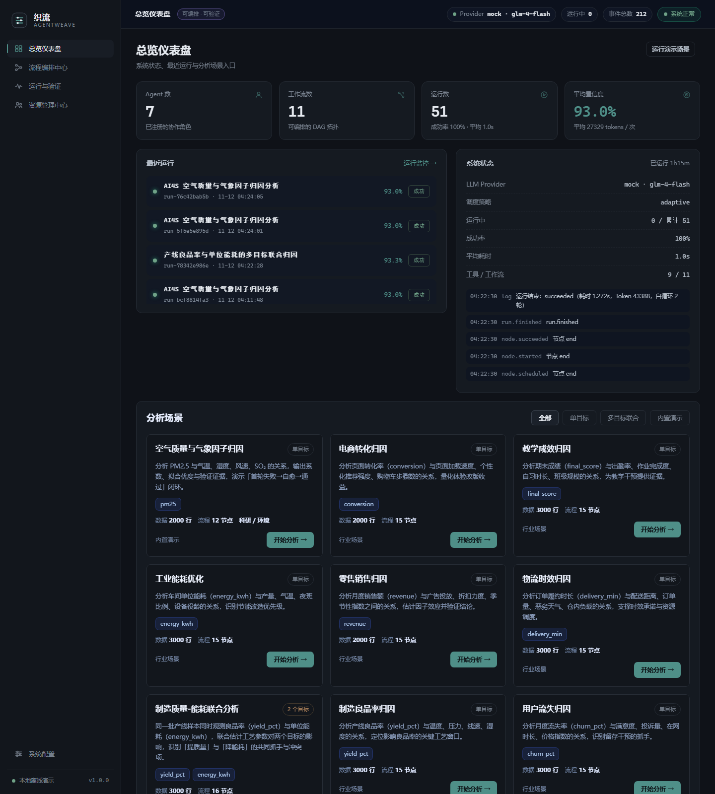
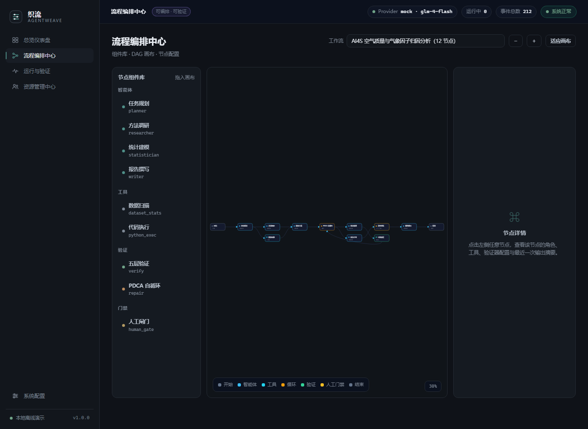
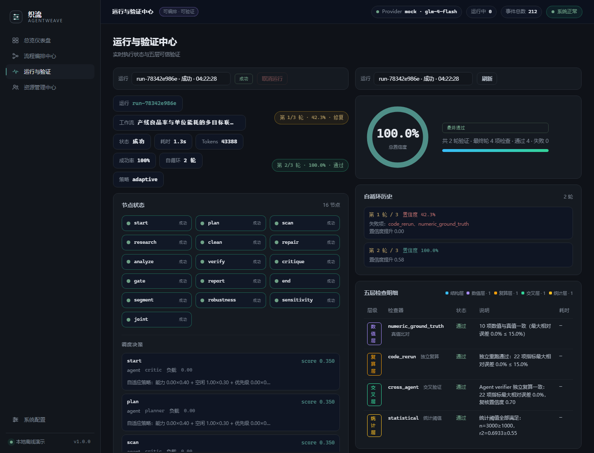
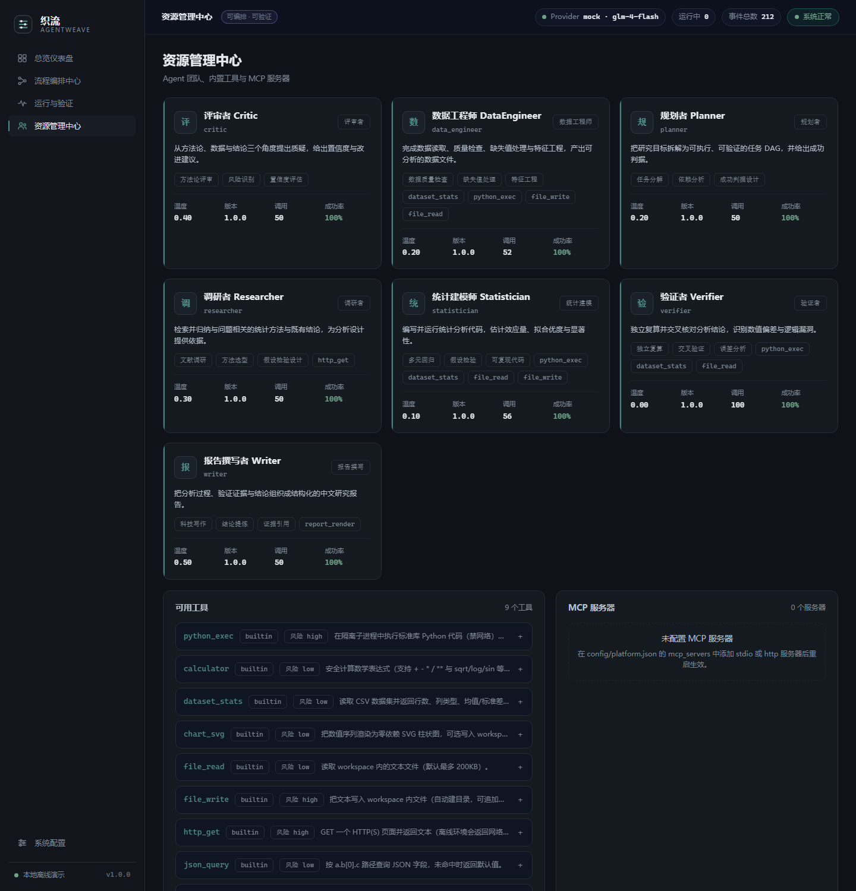
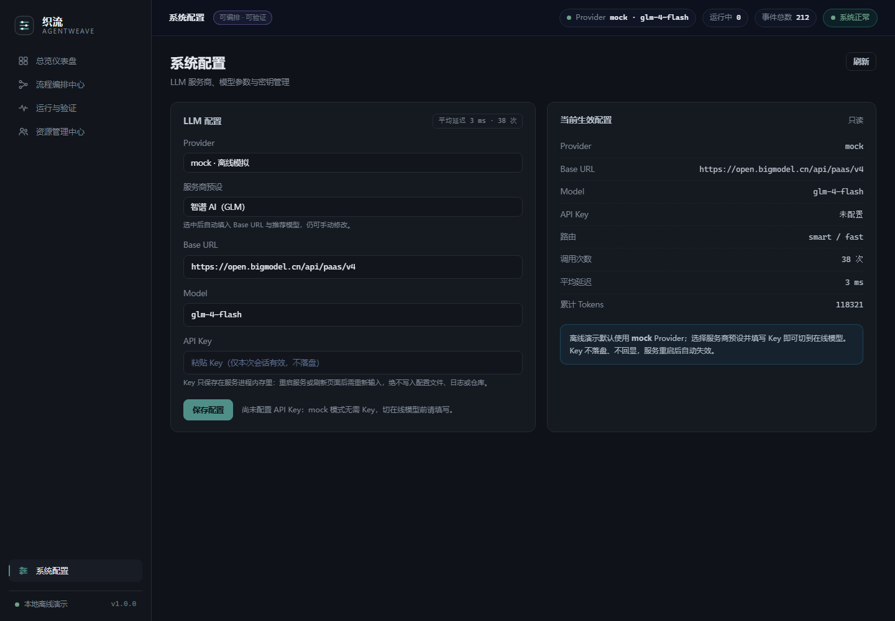

# 织流 AgentWeave

> 面向复杂科研任务的多智能体**编排 · 调度 · 可信验证**平台
> 多智能体编排、调度与可信验证平台
> 队伍名称：织流 AgentWeave　项目名称：织流 AgentWeave 多智能体编排调度与可信验证平台
> 代码仓库：<https://github.com/zhkb06/agentweave>
> 技术栈：Python 3.10+ 标准库 + 原生 JS，零第三方依赖；一键离线复现（内置确定性 Mock LLM）

## 它解决什么问题

多数 Agent 项目停在“能跑通 Demo”：流程硬编码、调度靠串行、结果无人复核。
织流把 Agent 系统当作**生产系统**来建设，聚焦四件真正工程化的事：

1. **可编排**：可视化 DAG，支持顺序、并行、条件分支、循环、子工作流、人工闸门；
2. **可调度**：基于 Agent 能力画像、负载、优先级、依赖就绪度的可解释调度打分；
3. **可验证**：代码独立复算、真值比对、跨 Agent 交叉验证、统计阈值、LLM 评审五层验证；
4. **能自愈**：PDCA 自循环把验证失败反馈注入下一轮执行，直到达标或耗尽预算。

## 三个“不只是 Demo”的设计

| 设计 | 说明 |
|---|---|
| **离线可复现** | 内置确定性 `MockProvider`，无网络、无 API Key 也能完整跑通“规划→并行→分析→验证失败→反馈修复→通过→报告”全链路，评审可一键复现 |
| **真值验证** | 演示场景使用带隐藏真值的数据集，验证器把模型估计的效应量与真值做误差比对，而不是让 LLM 自己说“我做对了” |
| **可解释调度** | 每次节点调度输出 `score / reason / agent_load`，前端实时展示“为什么是它执行” |

## 快速开始

```bash
# 环境：Python 3.10+，零第三方依赖
python server.py --port 8765 --open-browser
# Windows 若没有 python 命令：py -3.14 server.py
```

浏览器打开 <http://127.0.0.1:8765>，左侧 5 个入口对应五块工作：

| 页面 | 用来做什么 |
|---|---|
| **总览仪表盘** | 4 个关键指标 + 最近运行 + 系统状态；页面下半部分是分析场景入口 |
| **流程编排中心** | 左侧节点组件库 + 中间 DAG 画布 + 右侧节点配置 |
| **运行与验证中心** | 左：节点实时状态 / 调度决策 / 事件流；右：置信度、五层验证明细、自循环历史 |
| **资源管理中心** | 7 个 Agent 卡片 + 9 个内置工具 + MCP 服务器 |
| **系统配置** | LLM 服务商预设、Base URL、模型、会话级 Key |

普通用户的路径是：**总览仪表盘 → 选场景 → 开始分析 → 看结论与证据**；需要排查或调参时再进另外四页。

命令行运行（无需 Web）：

```bash
python scripts/run_demo.py          # 离线演示：完整编排 + 验证 + 自循环
python scripts/benchmark.py        # 多智能体 vs 单智能体基线对比
python -m unittest discover -s tests -t . -v
```

接入真实大模型（任意 OpenAI 兼容接口，如智谱 / DeepSeek / 通义千问）：

```bash
# 方式一：环境变量（适合服务器/命令行运行）
set AGENTWEAVE_API_KEY=sk-xxx
set AGENTWEAVE_BASE_URL=https://open.bigmodel.cn/api/paas/v4
set AGENTWEAVE_MODEL=glm-4-flash

# 方式二：仓库根目录 .env 文件（已 gitignore；真实环境变量 > .env > config/platform.json）
#   复制 .env.example 为 .env，填好后重启服务生效
AGENTWEAVE_API_KEY=sk-xxx
AGENTWEAVE_BASE_URL=https://api.deepseek.com/v1
AGENTWEAVE_MODEL=deepseek-chat

# 方式三（推荐）：Web「模型设置」页
#   1. 服务商预设下拉选择（智谱 / DeepSeek / 百炼 / 硅基流动 / Kimi / OpenAI / 自定义）
#   2. 自动填入 Base URL 与推荐模型，粘贴 Key 后保存
#   3. Key 只保存在服务进程内存：重启或刷新后需重新输入，
#      不写入 config/、日志或仓库，接口只回显“已配置/未配置”
```

> 默认模型为 **glm-4-flash**（快、便宜，适合现场演示）。未填 Key 时自动降级为离线 Mock，演示链路仍可完整跑通。

## 现场演示（5 分钟）

三种入口，任选其一：

| 方式 | 命令 | 适合 |
|---|---|---|
| 一键启动 Web | 双击 `启动.bat`，或 `py -3.14 server.py` | 现场/录屏，看完整界面 |
| 终端讲解式演示 | 双击 `演示.bat`，或 `py -3.14 scripts/demo_tour.py` | 网络不稳、要展示事件级证据 |
| 离线回放（无依赖） | 双击 `demo/演示回放.html` | 断网/投影故障/评委自行查看 |

逐段讲稿、数字速查、故障兜底与追问应答见 [`docs/演示手册.md`](docs/演示手册.md)；
真实运行的事件级全文见 [`docs/演示实录.md`](docs/演示实录.md)。

**本次演示真实结果**：12 节点、7 Agent、84 条事件；
第 1 轮验证失败（置信度 0.423，wind 偏差 34.4%，超出 15% 容差）→
结构化反馈注入 → 第 2 轮通过（置信度 1.000），自循环 2 轮收敛，
产物 `data/runs/<run_id>/`（report.md / metrics.json / events.jsonl / analysis_*.py）。

## 交付物清单

| 交付物 | 位置 | 说明 |
|---|---|---|
| 可运行代码 | 本仓库根目录 | 纯 Python 标准库 + 原生 JS，零第三方依赖，离线可跑 |
| 方案书 PDF | [`docs/方案书.pdf`](docs/方案书.pdf) | 48 页 / 约 1.89 万字，含架构、调度、验证、基准与 AI 使用说明 |
| 方案书源文件 | [`docs/方案书.md`](docs/方案书.md) | Markdown，便于评审检索与版本对比 |
| 项目白皮书 | [`docs/白皮书.pdf`](docs/白皮书.pdf) · [`.md`](docs/白皮书.md) | 16 页：项目概述、解决方案、应用成效、商业模式、团队介绍 |
| 演示 PPT | [`docs/织流AgentWeave-演示PPT.pptx`](docs/织流AgentWeave-演示PPT.pptx) | 14 页（符合 10–15 页要求），深色视觉，含讲者备注 |
| 演示视频脚本 | [`docs/视频脚本.md`](docs/视频脚本.md) | 4 分钟分镜（旁白/画面/操作/音效），可直接照录 |
| 演示视频 | [`docs/AgentWeave_演示视频_织流AgentWeave.mp4`](docs/AgentWeave_演示视频_织流AgentWeave.mp4) | 3:42，1920×1080 / 30fps，剪映工程直出（9 场景：真实界面录屏 + 幻灯片 + 剪映 TTS 旁白 + 自动字幕），构建脚本 `scripts/jy_build_v4.py` |
| 演示视频素材 | [`docs/视频素材/`](docs/视频素材) | 真实界面录屏 4 段（仪表盘 14s / 编排台与节点详情 21s / 运行监控 35s / 资源中心 9s），1920×1080 静音，供剪映配音剪辑 |
| 答辩预演 | [`docs/答辩预演.md`](docs/答辩预演.md) | Q1–Q10 + 速答卡 |
| 基准数据 | [`data/benchmark.json`](data/benchmark.json) | A/B/C 三模式实测，`scripts/benchmark.py` 可复现 |
| 运行截图 | [`screenshots/`](screenshots/) | 7 个页面终版截图（1600×1000） |

> 队伍信息：织流 AgentWeave ｜ 石家庄信息工程职业学院 ｜ 张康博 ｜ 指导教师：徐宇丰。仓库地址仍为占位，推送 GitHub/Gitee 后补充。

### 一条命令复现

```bash
py -3.14 scripts/run_demo.py      # 命令行：完整链路 + 自循环 + 报告
py -3.14 -m unittest discover -s tests -t . -v   # 206 个测试
py -3.14 scripts/benchmark.py     # 三模式基准（写入 data/benchmark.json）
py -3.14 server.py                # Web 控制台 http://127.0.0.1:8765
```

## 界面

| 总览仪表盘 | 流程编排中心 |
|---|---|
|  |  |

| 运行与验证中心 | 资源管理中心 | 系统配置 |
|---|---|---|
|  |  |  |

## 多场景演示（同一内核，换行业数据）

除默认的 AI4S 空气质量场景外，仓库内置 **10 个可直接运行的行业场景**（8 个单目标 + 2 个多目标联合分析），每个目录都是自包含的：
数据集 + 隐藏真值 + 工作流 JSON + 数据卡 + 说明。数据卡（`data_card.json`）记录生成方式、随机种子、字段、质量统计、许可与已知局限。单目标场景为 **15 节点**（比默认场景多出分层画像、稳健性检验、敏感性分析），两个多目标联合分析场景为 **16 节点**（再加一个「联合对比」节点），用于演示更复杂的编排。

| 场景目录 | 主题 | 目标 / 主要因子 | 一键运行 |
|---|---|---|---|
| `scenarios/finance-sales-attribution/` | 零售销售归因 | 营收 ← 广告投入、折扣、季节 | `py -3.14 scripts/run_scenario.py --scenario fin-sales` |
| `scenarios/public-health-risk/` | 公共卫生风险 | 发病率 ← 气温、湿度、疫苗率、PM2.5 | `py -3.14 scripts/run_scenario.py --scenario pub-health` |
| `scenarios/ecommerce-conversion/` | 电商转化归因 | 转化率 ← 页面速度、个性化、购物车步数 | `py -3.14 scripts/run_scenario.py --scenario ecom-conv` |
| `scenarios/manufacturing-yield/` | 制造良品率 | 良品率 ← 温度、压力、线速、湿度 | `py -3.14 scripts/run_scenario.py --scenario mfg-yield` |
| `scenarios/energy-consumption/` | 工业能耗优化 | 能耗 ← 产量、气温、夜班比例、设备役龄 | `py -3.14 scripts/run_scenario.py --scenario energy-kwh` |
| `scenarios/logistics-delivery/` | 物流时效归因 | 履约时长 ← 距离、订单量、天气、仓内负载 | `py -3.14 scripts/run_scenario.py --scenario logi-deliv` |
| `scenarios/education-performance/` | 教学成效归因 | 成绩 ← 出勤、作业、自习时长、班级规模 | `py -3.14 scripts/run_scenario.py --scenario edu-score` |
| `scenarios/marketing-churn/` | 用户流失归因 | 流失率 ← 满意度、投诉量、在网时长、价格指数 | `py -3.14 scripts/run_scenario.py --scenario mkt-churn` |
| `scenarios/manufacturing-quality-ops/` | 制造质量-能耗**多目标联合** | 良品率 + 能耗 ← 温度、压力、线速、湿度、产量 | `py -3.14 scripts/run_scenario.py --scenario mfg-ops` |
| `scenarios/marketing-growth/` | 营销增长**三目标联合** | 流失率 + LTV + CAC ← 满意度、投诉、在网时长、价格、广告 | `py -3.14 scripts/run_scenario.py --scenario mkt-growth` |

```bash
py -3.14 scripts/run_scenario.py --list   # 列出全部场景
py -3.14 scripts/run_scenario.py --all    # 10 个场景全部回归
```

每个场景都会完整走「首轮验证失败（42.3%）→ 结构化反馈 → 定向重跑 → 第二轮 100% 通过」，并附带 15/16 节点的事件流与报告。
多目标场景用 `<目标>.<因子>` 扁平键汇总指标，可一次联合分析任意数量目标；Web 编排台的工作流下拉框同样能看到全部场景，可直接在界面上运行。

## 生产化能力（可上线）

| 能力 | 说明 |
|---|---|
| 可选鉴权 | `AGENTWEAVE_AUTH_TOKEN` 或 `config.server.auth_token`，保护写接口；前端支持 `?token=` 一次性登录 |
| 限流 | 每 IP 每分钟运行类 10 次 / 其它写 60 次，超出 429 |
| 并发上限 | `runtime.max_concurrent_runs`，超出 429，避免一台机器被跑满 |
| 运行历史持久化 | 每次运行写 `summary.json`，重启后仍可查询历史；自动保留最近 50 次 |
| 指标与日志 | `GET /api/metrics`、轮转日志 `data/logs/agentweave.log`（含访问日志） |
| 安全头 | `X-Frame-Options` / `Referrer-Policy` / `Permissions-Policy` / `nosniff` |
| 部署物 | `Dockerfile`、`docs/上线部署指南.md`、`docs/生产化检查表.md` |

```bash
# 以生产模式启动（示例）
set AGENTWEAVE_AUTH_TOKEN=请替换为32位以上随机串
py -3.14 server.py --host 0.0.0.0 --port 8765
# 浏览器：http://127.0.0.1:8765/?token=请替换为32位以上随机串
```

> 诚实边界：单机单进程、规则验证为主、无多租户与分布式 worker；细节见 `docs/生产化检查表.md`。

## 架构

```
┌──────────────────────────── Web 控制台（原生 JS，无构建） ────────────────────────────┐
│  概览  │  编排台（DAG 画布）  │  运行监控（SSE）  │  验证中心  │  Agent 团队  │  工具/MCP  │
└───────────────────────────────────┬──────────────────────────────────────────────────┘
                                    │ REST + SSE
┌───────────────────────────────────▼──────────────────────────────────────────────────┐
│  API 层  agentweave/api/server.py（ThreadingHTTPServer + asyncio 循环线程）             │
├──────────────────────────────────────────────────────────────────────────────────────┤
│  运行时编排  orchestrator.py  →  WorkflowEngine（DAG 执行 / 并行 / 条件 / 循环 / 子流）   │
│      │            │                  │                │                │               │
│   Scheduler     SelfLoop         Verifier         RunState/Store    EventBus          │
│  能力+负载+优先级  PDCA 反馈修复    五层验证+置信度   快照/回滚/取消    事件流/SSE         │
├──────────────────────────────────────────────────────────────────────────────────────┤
│  Agent 运行时（ReAct · 工具调用 · 记忆）     工具层（内置工具 / MCP JSON-RPC 客户端）      │
│  AgentRegistry（版本管理 / 能力匹配 / 并发控制）  LLM Router（OpenAI 兼容 / 离线 Mock / 回退）│
└──────────────────────────────────────────────────────────────────────────────────────┘
```

## 目录

```
agentweave/            平台核心（纯标准库）
  core/                数据契约、事件总线、安全表达式
  workflow/            工作流模型、DSL、DAG 执行引擎
  scheduler/           可解释调度器（5 种策略）
  verify/              验证流水线与内置检查器
  loop/                自循环（PDCA）控制器
  runtime/             运行时上下文、编排器、运行状态
  agents/              Agent 注册表、ReAct 运行时、记忆
  tools/               工具注册表、内置工具、MCP 客户端
  llm/                 LLM 提供方、模型路由、离线 Mock
  api/                 HTTP/SSE 服务
  demo/                演示场景与数据
web/                   单页控制台
config/                Agent 团队、平台配置
workflows/             默认演示工作流（JSON DSL）
scenarios/             行业场景（数据集 + 真值 + 工作流），可独立运行
examples/datasets/     演示数据集（含隐藏真值）
tests/                 单元测试 + 集成测试
docs/                  方案书、PPT、视频脚本、契约文档
scripts/               演示与基准脚本
```

## 验证机制（五层）

| 层 | 检查器 | 作用 |
|---|---|---|
| L1 结构 | `schema` / `non_empty` | 输出契约、字段完整性 |
| L2 数值 | `numeric_ground_truth` | 与隐藏真值做相对误差比对（默认 15%） |
| L3 复算 | `code_rerun` | 独立重跑分析代码，比对指标 |
| L4 交叉 | `cross_agent` | 另一 Agent 独立复算并比对 |
| L5 语义 | `statistical` / `significance` | 样本量、R²、系数显著性（p ≤ 0.05） |
| L5 诊断 | `holdout_stability` / `multicollinearity` / `uncertainty` | 留出法稳定性、VIF 共线性、95% 置信区间是否跨 0 |
| L1 数据 | `data_quality` | 样本量、缺失率、重复行、离群率（硬性检查） |
| L4 交叉 | `llm_judge` | 可选结构化评审，默认关闭以保证确定性 |
| 综合 | 加权置信度 | `confidence ≥ min_confidence` 才放行，否则触发自循环 |

## 目录约定

- 纯标准库、无 CDN、无外部服务即可演示；
- 所有配置本地化，API Key 只经环境变量或本机配置文件，不在日志/接口中回显；
- 工作流 JSON 可版本化、可审阅、可复现。

## License

MIT，见 [LICENSE](LICENSE)。
