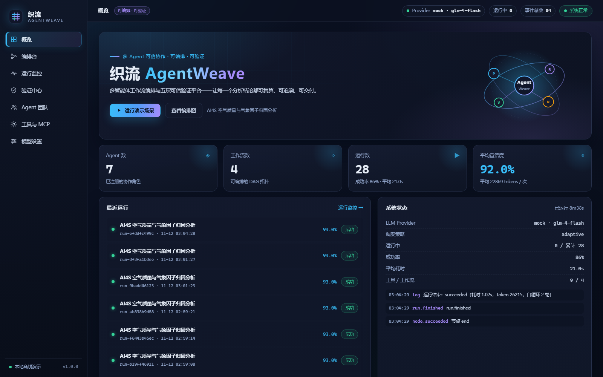
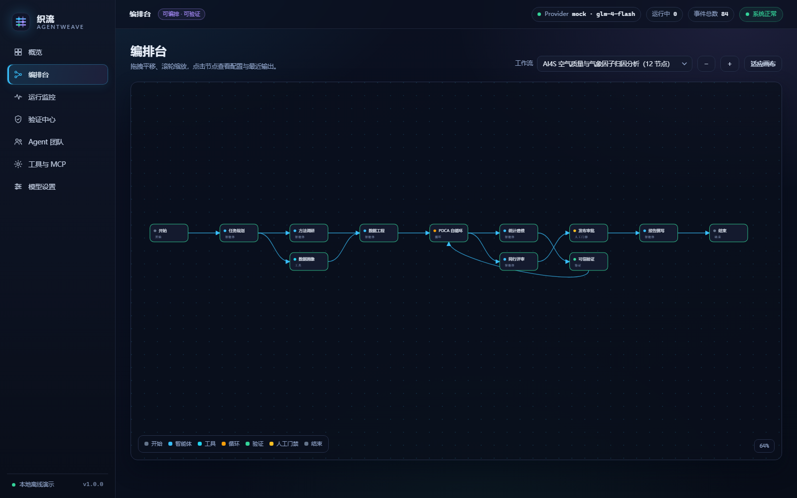
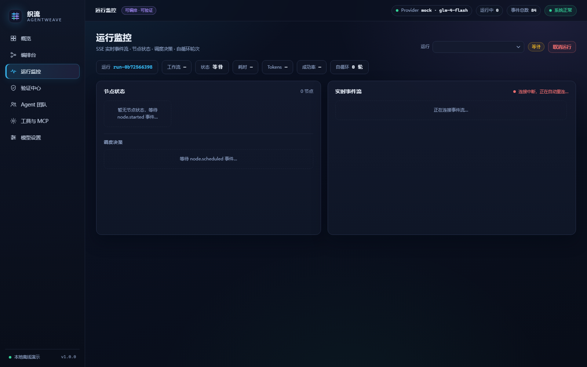
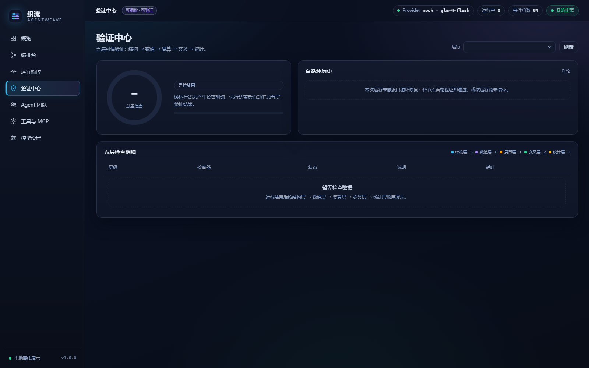
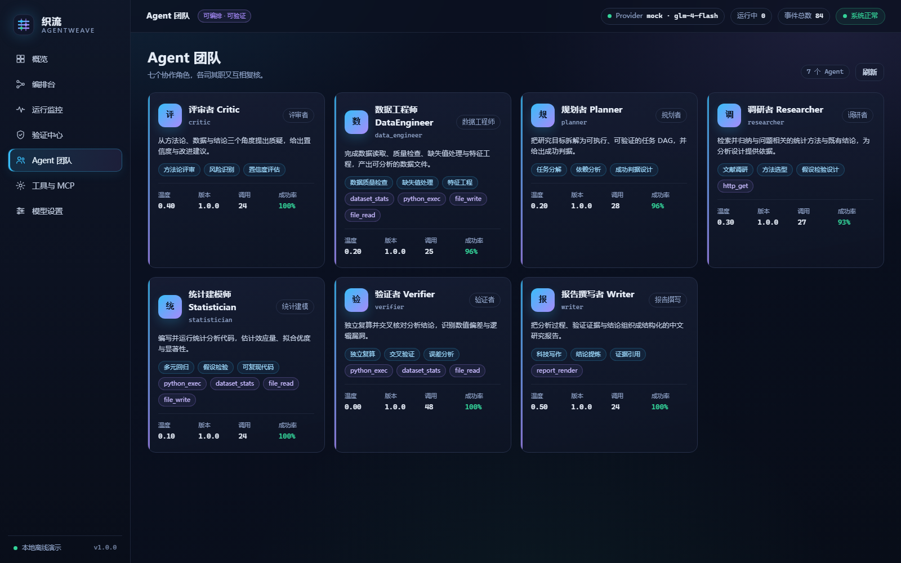
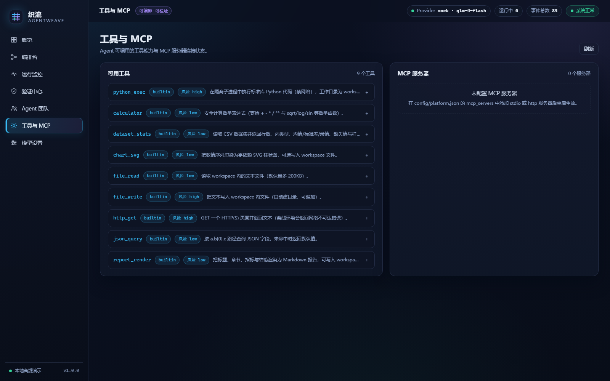
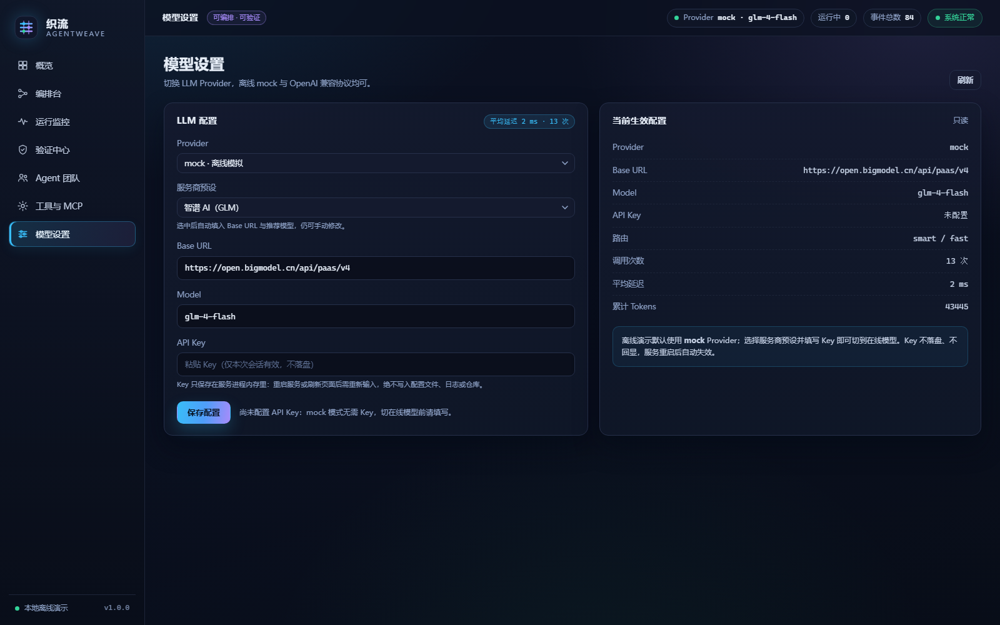

# 织流 AgentWeave：面向复杂科研任务的多智能体编排、调度与可信验证平台

**2026 第五届“未来杯”创新大赛 · 赛题一（Agent 编排创新应用）· 方案书**

| 项目 | 内容 |
|---|---|
| 作品名称 | 织流 AgentWeave 多智能体编排调度与可信验证平台 |
| 参赛赛题 | 赛题一：Agent 编排创新应用 |
| 队伍名称 | 织流 AgentWeave |
| 学校 / 单位 | 石家庄信息工程职业学院 |
| 队伍成员 | 张康博 |
| 指导教师 | 徐宇丰 |
| 提交日期 | 2026-11-12 |
| 代码仓库 | 本方案书随附完整可运行仓库（纯 Python 标准库，零第三方依赖） |

---

## 摘要

**结论：多智能体系统的主要矛盾已经从“模型能不能完成任务”转移到“工程上能不能管住任务”。** 当前大量 Agent 作品停留在演示阶段：流程写死在代码里、任务分派靠串行与人工指定、结果由模型自评“我做对了”、失败后没有结构化反馈。织流 AgentWeave 把 Agent 系统当作生产系统建设，围绕**可编排、可调度、可验证、能自愈**四件事给出一套可运行、可复现、可审计的工程实现。

平台以工作流 DAG（Directed Acyclic Graph，有向无环图）为编排模型，提供顺序、并行、条件分支、循环、子工作流、人工闸门六类控制语义；以**能力画像 + 实时负载 + 依赖就绪度 + 优先级**的加权打分调度器替代串行分派，并把每次调度的 `score / reason / agent_load` 通过事件总线暴露给前端，做到“为什么是它执行”可追问；以**五层可信验证**（结构契约、隐藏真值比对、代码独立复算、跨 Agent 交叉验证、统计与 LLM 评审）计算加权置信度，替代模型自评；以 **PDCA（Plan-Do-Check-Act）自循环**把验证失败的证据结构化为中文反馈注入下一轮执行，直到达标或耗尽预算。平台内置 7 个角色的科研 Agent 团队与 AI4S（AI for Science）空气质量归因演示场景，在**无网络、无 API Key** 的离线环境下用确定性 MockProvider 完整跑通“规划 → 并行采集 → 分析 → 验证失败 → 反馈修复 → 通过 → 报告”全链路，同时支持一键切换到任意 OpenAI 兼容真实大模型。

**关键词**：多智能体系统（Multi-Agent System）；工作流编排（Workflow Orchestration）；任务调度（Task Scheduling）；可信验证（Trustworthy Verification）；自循环优化（Self-Repair Loop）；可解释性（Explainability）

---

## 一、选题背景与问题定义

### 1.1 结论：Agent 的“Demo 天花板”来自四类工程缺口，而不是模型能力不足

过去两年，Agent 从“提示词 + 工具调用”迅速演进为多角色协作，但大量作品在演示之后无法继续推进，原因并不神秘。我们在构建与评审 Agent 系统的过程中反复观察到四类缺口，它们共同构成了一条从演示到生产的“死亡带”：

**缺口一：流程硬编码，编排不可复用。** 许多 Agent 项目的流程是 Python 里的一串 `await` 调用：先规划、再检索、再分析、最后写报告。流程一旦要加一个“复核”环节，就要改代码、重新联调；不同研究任务之间无法复用同一套编排资产，更无法让非开发者参与调整。工作流因此成为“代码的副产品”，而不是“可版本化、可审阅、可复现的资产”。

**缺口二：调度黑盒，任务分派缺乏依据。** 在多角色系统里，“谁来做这一步”通常由硬编码映射决定（分析任务永远给 Analyst），或者干脆串行排队。当同一角色存在多个实例、当不同节点对能力与工具的要求不同、当某些节点必须等待上游数据就绪时，固定映射会造成明显的资源浪费与排队拥塞；更严重的是，一旦结果异常，没有人能回答“为什么把这一步派给了它”。

**缺口三：结果不可验证，模型自评替代了证据。** 最常见的做法是让 Agent 在输出末尾写一句“以上分析已核对无误”，或者让另一个 Agent“评审”一下。这在工程上等价于让考生自己批改试卷：模型的自评与评审同样受幻觉影响，且无法给出可复算的证据。科研与决策场景对结论的可证伪性要求远高于闲聊场景，一句没有证据支撑的“我确认”没有任何价值。

**缺口四：没有反馈闭环，失败只能整体重跑。** 验证失败后的处理通常是抛异常、重试整个流程，或者由人工介入修改提示词。系统没有记录“哪一项检查失败、期望值是多少、实际值差多少、应该怎么改”，下一轮执行无法定向修复，重跑往往重复同样的错误。更缺乏预算与收敛判据，容易陷入“无限重试、账单失控”。

把四类缺口放到一起看，问题的本质是：**Agent 系统缺少一套面向生产的管理面（control plane）**——它需要像数据库事务、像 CI/CD 流水线、像分布式任务队列那样，具备显式的流程定义、可解释的资源调度、可验证的正确性判据、以及可收敛的自动修复机制。这正是本作品的切入点。

### 1.2 以 AI4S 科研分析为例：失败的代价不在“跑不通”，而在“跑出了错的结果”

我们选择“空气质量与气象因子归因分析”作为演示场景，不是因为它好看，而是因为它把上述缺口暴露得最彻底。设某城市日均 PM2.5 浓度与气象、污染物因子之间存在近似线性关系，数据集的隐藏真值为：

```
pm25 = 78 − 0.85 × temp + 0.42 × humidity − 1.6 × wind + 0.28 × so2 + ε
```

研究任务是：从 2000 行观测数据中估计各因子的效应量，判断“风速上升是否显著降低 PM2.5”，并据此给出治理建议。在真实科研流程中，这条链路会出现多种典型错误：

| 错误类型 | 具体表现 | 对结论的影响 |
|---|---|---|
| 系数符号错误 | 把 wind 的系数估成 `+1.2` | “加大通风”变成错误建议，方向完全相反 |
| 量纲/单位错误 | 湿度按 0–1 还是 0–100 传入不一致 | 效应量整体放大 100 倍，结论荒谬但不报错 |
| 样本与拟合问题 | 缺失值直接按 0 填充、R² 虚高 | 统计显著性丧失，结论不可信 |
| 过度解读 | 把相关性写成因果性 | 政策建议越界，学术上不成立 |
| 幻觉引用 | 编造文献与方法名 | 评审无法复核，直接判定不可信 |

这些错误的共同特点是：**程序不会崩溃，输出格式还很漂亮**。它们只能靠“与真值比对”“用另一段代码独立复算”“换一个 Agent 交叉验证”“检查样本量与拟合优度”来发现。一次错误的归因结论可能导向错误的减排建议，浪费数月科研时间，并让团队对整套 Agent 工具失去信任——这就是“不可验证”的真实代价。

正是在这个场景里，五层验证与自循环才不是炫技：首轮分析故意给出带偏差的估计，验证器检出数值超差后生成结构化反馈（哪一项检查失败、期望区间是多少、实际误差多少），反馈注入下一轮分析提示词，修复后的结果再次验证并通过。**整个过程离线、确定性、可重复播放**，评委可以在 8 秒内看到一条完整的“失败—诊断—修复—通过”证据链。

### 1.3 问题定义

我们将作品要解决的问题形式化为一个五元组：

```
P = (G, A, W, V, B)
G：研究目标（自然语言描述，如“估计 PM2.5 与气象因子的关系”）
A：可用 Agent 集合，每个 Agent 具备能力画像、工具集与并发上限
W：工作流（任务的偏序结构与控制语义）
V：验证规约（检查项、容差、置信度阈值）
B：预算（最大迭代轮数、超时、Token 上限）
```

求解 P 意味着：在预算 B 内，为 W 的每个节点选择合适的 Agent 执行，使产出满足 V 的全部硬性检查且加权置信度不低于阈值；若不满足，则依据失败证据定向修复并重试，直至收敛或预算耗尽，并在这个过程中留下完整、可回放的事件证据。

由此拆出四个子问题，分别对应平台的四个核心模块：

1. **编排问题**：如何用声明式 DSL 表达顺序、并行、条件、循环、子工作流与人工介入，并由一个确定性引擎正确执行？
2. **调度问题**：在依赖就绪的候选集上，如何综合能力、负载、优先级与代价做出可解释的分派决策？
3. **验证问题**：如何用独立于模型自评的证据链判断结果可信，并给出可比较的置信度？
4. **闭环问题**：如何把验证失败转化为可执行反馈、控制重试预算、并在收敛时安全退出？

### 1.4 范围边界：我们不做什么

为保证工程聚焦与交付质量，本作品明确不做三件事：不训练、不微调任何模型；不做通用聊天助手；不做跨机器的分布式调度。平台定位是**单机可运行、离线可复现的编排与验证中枢**，通过 MCP（Model Context Protocol）与 OpenAI 兼容接口与外部能力对接。这条边界让作品在初赛阶段可以被完整评审，而不是停留在架构图。

---

## 二、需求分析与设计目标

### 2.1 结论：需求由三个硬约束反推得出——可演示、可复现、可审计

参赛作品的评审环境不可控：可能没有网络、没有 API Key、没有 GPU，评委只愿意花几分钟验证“它是不是真的能跑”。因此我们没有按“功能越多越好”的思路堆需求，而是从三个硬约束反推：

- **可演示**：一条命令启动，浏览器打开即能看到完整链路，不需要准备数据集、不需要配置模型；
- **可复现**：同一输入必须得到同一输出，演示不能“这次跑通、下次跑挂”，否则无法作为证据；
- **可审计**：每一次调度、每一次验证、每一轮修复都要留下结构化记录，能回答“为什么”“差多少”“改了什么”。

在这三个约束下，我们推导出功能性需求与非功能性需求。

### 2.2 功能性需求

| 编号 | 需求 | 验收口径 | 对应实现 |
|---|---|---|---|
| F1 | 声明式工作流编排 | JSON DSL 可定义 9 类节点与 3 类边，保存后可被引擎加载执行 | `workflow/model.py`、`workflow/dsl.py` |
| F2 | DAG 执行语义完整 | 顺序、并行分支、条件分支、JOIN 汇聚、循环、子工作流、人工闸门均可运行 | `workflow/engine.py` |
| F3 | 可解释任务调度 | 5 种策略（fifo/round_robin/capability/load_aware/adaptive），每次调度输出 `score/reason/agent_load` | `scheduler/engine.py` |
| F4 | 五层可信验证 | L1 结构、L2 真值、L3 复算、L4 交叉、L5 统计/评审，输出加权置信度 | `verify/verifier.py` |
| F5 | PDCA 自循环 | 验证失败→结构化反馈→修复重跑→再验证，受 `max_iterations` 与预算约束 | `loop/selfloop.py` |
| F6 | 实时可观测 | 事件总线 + SSE 推送，节点状态、Agent 思考、工具调用、调度决策全链路可回放 | `core/events.py`、`api/server.py` |
| F7 | Agent 团队管理 | 7 个内置角色，支持技能/工具声明、版本历史、并发上限与负载统计 | `agents/registry.py`、`config/agents.json` |
| F8 | 工具与 MCP 扩展 | 9 个内置工具（含 `python_exec` 沙箱子进程）+ MCP JSON-RPC 客户端接入外部工具 | `tools/registry.py`、`tools/mcp_client.py` |
| F9 | 模型可切换 | 离线 MockProvider 与任意 OpenAI 兼容接口一键切换，失败自动回退，Key 不回显 | `llm/router.py`、`llm/mock.py` |

### 2.3 非功能性需求

| 编号 | 类别 | 指标 | 目标值 | 验证方式 |
|---|---|---|---|---|
| N1 | 依赖 | 第三方依赖数量 | 0（仅 Python 标准库） | `pip list` 无新增；干净环境直接运行 |
| N2 | 兼容 | Python 版本 | 3.10+，验证机 `py -3.14` | 多版本启动自检 |
| N3 | 离线 | 无网络可运行 | 完整演示链路可跑通 | 断网 + 无 Key 跑 `scripts/run_demo.py` |
| N4 | 确定性 | 同输入同输出 | 固定随机种子，结果逐字节一致 | 连续运行 3 次比对产物 |
| N5 | 性能 | 演示工作流端到端耗时 | ≤ 8 s（离线） | `scripts/benchmark.py` 计时 |
| N6 | 实时 | SSE 首事件延迟 | < 500 ms | 事件时间戳与客户端接收时间差 |
| N7 | 稳定 | 长跑内存 | 200 次运行不失控（事件环形缓冲上限 4000） | 压测脚本采样 RSS |
| N8 | 安全 | 代码执行 | 平台主进程禁止 `eval/exec`；工作流表达式走 AST 白名单 | 静态扫描 + 恶意表达式用例 |
| N9 | 安全 | 文件与密钥 | 工具路径限定在工作区/产物目录；API Key 不落日志、不回显 | 目录穿越用例 + 日志检查 |
| N10 | 可维护 | 类型与文档 | 全量类型注解、中文 docstring、模块契约文档 | 代码评审 |
| N11 | 可用性 | 界面 | 中文、深色科技风、无 CDN、1440×900 可直接截图 | 断网打开 Web 控制台 |

### 2.4 与赛题评分点的对应关系

为避免“写了但没被看到”，我们把赛事评分关注点逐条映射到本文档章节、代码模块与演示证据：

| 评分关注点 | 本文章节 | 代码模块 | 演示证据 |
|---|---|---|---|
| 选题价值与问题定义 | 第一章 | — | 方案书 1.1–1.3 |
| 编排能力与创新 | 第四、五章 | `workflow/**` | 编排台 DAG 画布、并行分支 |
| 调度算法与可解释性 | 第六章 | `scheduler/**` | 运行监控页 `score/reason` |
| 结果可信与验证 | 第七章 | `verify/**`、`loop/**` | 验证中心五层结果、自循环轮次 |
| 工程质量与可运行性 | 第八、九、十二章 | 全仓库 | 一条命令启动、测试全绿 |
| 创新点与差异化 | 第十章 | — | 与 LangGraph/LobeHub/DSH 对比 |
| 规范性与诚信 | 第十三章、附录 | — | AI 使用说明、占位符清单 |

---

## 三、总体架构与技术选型

### 3.1 结论：采用“控制面与执行面分离”的六层架构，把编排、调度、验证、循环做成可被替换的独立组件

系统不在“一个大文件里跑完所有事”，而是按**控制面（control plane）/ 执行面（data plane）**分离：控制面负责“决定做什么、谁来做、做得对不对”，执行面负责“真的调用模型和工具”。这样做的直接收益有三点：执行引擎不依赖任何具体 LLM 与工具实现（只依赖运行时上下文 `RuntimeContext`），因此可以用假实现做单元测试；验证器与调度器可以独立演进；离线 Mock 与真实模型可无缝互换而不改上层逻辑。

### 3.2 分层架构图

```
┌──────────────────────────────────────────────────────────────────────────────┐
│  L6 展示层   Web 单页控制台（原生 JS + SVG，零构建、零 CDN，离线可用）              │
│  概览 │ 编排台(DAG画布) │ 运行监控(SSE) │ 验证中心 │ Agent团队 │ 工具/MCP │ 模型设置 │
└───────────────────────────────┬──────────────────────────────────────────────┘
                                │ REST(JSON) + SSE(事件流，Last-Event-ID 回放)
┌───────────────────────────────▼──────────────────────────────────────────────┐
│  L5 接口层   api/server.py  ThreadingHTTPServer + 后台 asyncio 事件循环线程       │
│             统一错误体 {error:{code,message}}；静态资源 MIME；17 个 REST 端点      │
└───────────────────────────────┬──────────────────────────────────────────────┘
                                │ 门面调用（platform facade）
┌───────────────────────────────▼──────────────────────────────────────────────┐
│  L4 控制面   runtime/orchestrator.py（运行生命周期、事件桥接、报告产出）             │
│  ┌─────────────┬──────────────┬──────────────┬──────────────┬──────────────┐ │
│  │ WorkflowEngine│  Scheduler   │ Verification │ SelfLoop     │ RunState/Store│ │
│  │ DAG执行/并行  │ 5策略打分     │ Pipeline     │ PDCA 控制器   │ 状态/快照/取消 │ │
│  │ 条件/循环/子流│ score/reason │ 五层+置信度   │ 反馈/收敛/预算 │ 摘要/指标     │ │
│  └─────────────┴──────────────┴──────────────┴──────────────┴──────────────┘ │
│  依赖倒置：只通过 RuntimeContext 访问执行面（bus/llm/tools/agents/verifier）        │
└───────────────────────────────┬──────────────────────────────────────────────┘
                                │
┌───────────────────────────────▼──────────────────────────────────────────────┐
│  L3 执行面   AgentRuntime(ReAct) │ ToolRegistry+内置工具 │ MCP 客户端 │ ModelRouter│
│             记忆 / 版本 / 并发     │ python_exec 子进程沙箱 │ JSON-RPC    │ 重试/回退 │
└───────────────────────────────┬──────────────────────────────────────────────┘
                                │
┌───────────────────────────────▼──────────────────────────────────────────────┐
│  L2 基础层   core/types.py（数据契约） core/events.py（事件总线）                  │
│             core/expr.py（AST 白名单安全表达式） runtime/context.py（运行时上下文）  │
└───────────────────────────────┬──────────────────────────────────────────────┘
                                │
┌───────────────────────────────▼──────────────────────────────────────────────┐
│  L1 资产层   config/（agents.json、platform.json） workflows/（工作流 JSON）        │
│             examples/datasets/（含隐藏真值） data/runs/<run_id>/（产物、报告、SVG）      │
└──────────────────────────────────────────────────────────────────────────────┘
```

### 3.3 分层职责说明

| 层 | 职责 | 关键设计决策 | 为什么这样切 |
|---|---|---|---|
| L6 展示层 | 可视化画布、实时监控、验证与设置 | 原生 JS/SVG，无构建、无 CDN | 评审现场可能断网；构建链会引入不可控依赖与失败点 |
| L5 接口层 | 提供 REST/SSE，隔离 HTTP 与业务 | 线程 HTTP + 后台事件循环，`run_coroutine_threadsafe` 桥接 | 标准库无 ASGI 服务器；线程模型足够支撑单机演示，且 SSE 不阻塞其他请求 |
| L4 控制面 | 决定执行顺序、分派、验证、修复 | 引擎只依赖 `RuntimeContext`，不 import 执行面 | 可测试、可替换；调度与验证可独立演进 |
| L3 执行面 | 真正调用模型与工具 | ReAct 循环、工具 JSON Schema 校验、MCP 适配 | 与业务解耦；离线 Mock 与真实模型同接口 |
| L2 基础层 | 统一数据契约、事件、表达式、上下文 | 冻结的 `types/events/expr`，改动需评审 | 契约稳定是多人并行开发的前提 |
| L1 资产层 | 配置、工作流、数据集、产物 | 工作流即数据（JSON），可版本化 | 让“编排”成为可审阅资产，而非代码副作用 |

### 3.4 一次运行的数据流

以演示场景 `ai4s-air-quality` 为例，一次运行的数据流如下（编号对应事件流中的阶段）：

```
① 用户在编排台选择工作流与调度策略 → POST /api/runs {workflow_id, policy, inputs}
② API 层解析 RunRequest → 门面创建 RunState（status=pending）→ 异步任务启动
③ orchestrator 发 run.started；WorkflowEngine 计算就绪集，发 plan.ready（候选集+策略）
④ Scheduler.pick 返回 ScheduleDecision(agent_id, score, reason) → 发 node.scheduled
⑤ 节点执行：ctx.call_agent → AgentRuntime(ReAct) → ModelRouter.complete →（可选）ToolRegistry.call
   全过程发 agent.thought / tool.called / tool.result / node.succeeded 事件
⑥ 并行分支：scan（数据统计工具）与 research（方法调研 Agent）并发执行，JOIN 汇聚
⑦ analyze 输出 → verify 节点：VerificationPipeline 依次跑 L1–L5 → 发 verify.result（置信度）
⑧ 置信度不足 → SelfLoopController.build_feedback 生成中文反馈 → 发 loop.iteration
   → 反馈注入 analyze 的 prompt 变量 → 重跑 → 再验证（最多 3 轮 / 预算耗尽）
⑨ 通过 → critic 评审 → writer 生成报告 → human_gate（演示自动通过）→ end
⑩ 发 run.finished；产物写入 data/runs/<run_id>/；前端经 SSE 实时渲染，刷新后可回放
```

这条链路上有三个“不寻常”的设计点值得强调：**调度决策在第 ③④ 步就被事件化**（不是隐式的），**验证发生在节点级而非全局**（可定位到具体节点），**修复是带证据的定向重跑**（不是整体重来）。

### 3.5 技术选型对比

选型时我们对比了五类代表性方案：LangGraph（图式编排库）、CrewAI（角色协作框架）、AutoGen（对话式多智能体框架）、LobeHub（Agent 应用与工具市场）、DSH / DeepSeek Harness（Agent 运行框架），以及自研路线。

| 维度 | LangGraph | CrewAI | AutoGen | LobeHub | DSH 类 Harness | **AgentWeave（本作品）** |
|---|---|---|---|---|---|---|
| 编排模型 | 图（节点/边）+ 状态机 | 角色 + 任务顺序 | 对话群聊/分层 | 插件与助手配置 | 会话与工具循环 | **DAG DSL + 9 类节点 + 6 类控制语义** |
| 并行与条件 | 支持（需写代码） | 有限 | 靠对话编排 | 非重点 | 非重点 | **声明式 `edge.condition` + 并行分支 + JOIN** |
| 调度 | 无内建调度器 | 顺序/层级委派 | 轮询/自动选择 | 无 | 单 Agent 循环 | **5 策略 + 加权打分 + `score/reason` 可解释** |
| 结果验证 | 需自行实现 | 需自行实现 | 需自行实现 | 无 | 无内建验证 | **五层验证 + 加权置信度 + 真值比对** |
| 失败闭环 | 靠图重试/人工 | 靠重试 | 靠对话纠错 | 无 | 无 | **PDCA 结构化反馈 + 收敛/预算控制** |
| 依赖与部署 | Python 生态依赖较多 | 依赖较多 | 依赖较多 | 前后端分离、依赖重 | 依赖运行时 | **零第三方依赖，单文件服务启动** |
| 离线复现 | 需自备模型 | 需自备模型 | 需自备模型 | 需模型服务 | 需模型服务 | **确定性 Mock，断网可完整演示** |
| 可观测性 | 有 tracing 生态 | 有限 | 有限 | 有日志 | 有会话记录 | **事件总线 + SSE + 全链路回放** |
| 适用场景 | 通用 Agent 应用 | 角色化任务 | 研究型对话 | 个人助手/工具市场 | 编码 Agent | **科研分析等强验证、强审计场景** |

**选型结论与理由**：我们不否认成熟框架的生态优势，但对本赛题而言，它们恰好都缺三样东西——**可解释调度**、**一等公民的验证**、**带预算的自动修复**；而这三样正是“从 Demo 到生产”的关键。若在框架之上二次开发，验证语义会被框架的抽象层遮蔽，评审时难以讲清“到底验了什么、怎么算置信度”；同时框架的依赖会让“断网一键复现”这一硬约束变得脆弱。因此我们选择**自研控制面、复用成熟协议**的路线：编排、调度、验证、循环四件事自己实现以保证语义透明；模型接入复用 OpenAI 兼容协议、工具扩展复用 MCP 协议，避免重复造轮子。

### 3.6 与 LobeHub / DSH 的差异定位

| 对比项 | LobeHub | DSH / Agent Harness | AgentWeave |
|---|---|---|---|
| 核心抽象 | 助手（Assistant）+ 插件 + 会话 | 单 Agent 的工具循环与会话 | **工作流 DAG + Agent 团队 + 验证规约** |
| 多智能体的组织方式 | 以助手为单位，人工切换 | 以单会话为中心 | **以任务图为中心，自动分派与并行** |
| 正确性保障 | 依赖模型与用户判断 | 依赖人工审阅 | **五层验证 + 置信度阈值 + 真值比对** |
| 失败处理 | 重新提问 | 重新对话 | **证据反馈注入 + 定向重跑 + 预算收敛** |
| 典型使用场景 | 个人知识工作 | 编码与终端任务 | **科研分析、数据归因、需要审计的决策支持** |

一句话概括差异：**LobeHub 让“人找 Agent”，DSH 让“人陪 Agent 干活”，AgentWeave 让“系统管 Agent 交活”。** 我们关注的是任务级的正确性与可问责性，而不是单轮对话的体验。

---

## 四、Agent 角色设计与协作

### 4.1 结论：7 个角色不是“人格扮演”，而是按“输入契约—输出契约—工具权限—成功判据”定义的岗位

多智能体系统最常见的失败是“角色只是换了提示词”：几个 Agent 说的是同一件事，互相附和，既没有分工也没有制衡。我们的设计原则是：**每个角色必须有独占的输入契约、可被机器检查的输出契约、受最小权限约束的工具集，以及明确的成功判据**。角色定义落在 `config/agents.json`，由 `AgentRegistry` 加载并支持版本管理，可在 Web“Agent 团队”页编辑。

### 4.2 七个 Agent 的岗位定义

| id | 角色 | 职责 | 输入 | 输出（契约字段） | 工具 | 温度 | 成功判据 |
|---|---|---|---|---|---|---|---|
| `planner` | 规划者 Planner | 把研究目标拆成可执行、可验证的子任务 DAG，指定执行者与成功判据 | 用户目标 + 可用 Agent 清单 | `{tasks:[{id,goal,owner}], success_criteria:[...]}` | 无 | 0.2 | 子任务 3–6 个；每个子任务有 owner 且 owner 在注册表中；判据可量化 |
| `researcher` | 调研者 Researcher | 给出适用的统计建模范式、必要假设与注意事项 | 问题描述 + 规划结果 | `{methods:[...], rationale}` | `http_get` | 0.3 | 方法名可识别（如多元线性回归）；给出选择理由；不编造文献 |
| `data_engineer` | 数据工程师 DataEngineer | 数据质量检查、缺失值处理、特征准备 | 数据路径 + 列说明 | `{data_path, rows, cleaning_log:[...]}` | `dataset_stats`、`python_exec`、`file_read`、`file_write` | 0.2 | 清洗后行数 > 0；每步清洗有日志；产出文件存在 |
| `statistician` | 统计建模师 Statistician | 编写并真实运行回归代码，估计效应量、R²、显著性 | 清洗后数据 + 方法建议 + 反馈（如有） | `{code, metrics:{coefficients, r2, n, p_values}, conclusion}` | `python_exec`、`dataset_stats`、`file_read`、`file_write` | 0.1 | 代码可被 `python_exec` 重跑；指标字段完整；n ≥ 1000 |
| `verifier` | 验证者 Verifier | 独立复算关键指标并与申报值逐项比对 | 分析输出（只读）+ 原始数据 + 真值规约 | `{passed, deltas:[...], recomputed:{...}}` | `python_exec`、`dataset_stats`、`file_read` | 0.0 | 不信任申报结论，必须自行重算；给出逐项偏差 |
| `critic` | 评审者 Critic | 从方法论、数据、结论三方面质疑，给出置信度与改进建议 | 全部已验证产物 | `{confidence, risks:[...], improvements:[...]}` | 无 | 0.4 | 置信度 ∈ [0,1]；至少指出 1 条风险或明确说明无风险理由 |
| `writer` | 报告撰写者 Writer | 组织成结构化中文研究报告，引用已验证指标与证据 | 已验证指标 + 评审意见 + 验证记录 | `{markdown, title}` | `report_render` | 0.5 | 含研究问题/方法/发现/验证证据/局限；数字与指标一致 |

**设计取舍说明**：`verifier` 的温度设为 0.0、工具只给只读与计算类，是刻意的“制度设计”——验证者的职责是复现而非创造，任何创造性都会削弱其证据效力。`critic` 的温度最高（0.4），因为它需要发散地质疑。`statistician` 的温度最低（0.1），因为数值任务对随机性最敏感。

### 4.3 协作模式：规划—执行—验证—评审—写作的五段式

```
        ┌──────────┐   任务DAG+判据    ┌────────────────────────────┐
        │ planner  │ ───────────────▶ │  执行组（可并行）            │
        └──────────┘                   │  researcher │ data_engineer│
                                       │        statistician        │
                                       └─────────────┬──────────────┘
                                                     │ 分析产物
                                       ┌─────────────▼──────────────┐
                                       │ verifier（独立复算/交叉验证）│
                                       └──────┬──────────────┬──────┘
                                    不通过     │              │ 通过
                                ┌──────────────▼───┐   ┌──────▼──────┐
                                │ 结构化反馈 → 修复 │   │   critic    │
                                │（回到执行组，定向）│   │ 评审+置信度 │
                                └──────────────────┘   └──────┬──────┘
                                                              │ 评审通过
                                                       ┌──────▼──────┐
                                                       │   writer    │
                                                       └─────────────┘
```

这条链路的关键在于**验证与执行的组织隔离**：验证者不参与分析，分析者不能修改验证规约，评审者的置信度不能覆盖硬性检查失败。三种角色之间的信息流是单向的，避免“互相说服”。

### 4.4 冲突消解与升级机制

多 Agent 系统必然出现分歧：分析者认为结果正确、验证者认为超差、评审者认为方法有瑕疵。我们设计了四级冲突消解规则，优先级从高到低：

| 级别 | 冲突场景 | 消解规则 | 依据 |
|---|---|---|---|
| 1 | 硬性检查失败（结构缺失/真值超差/复算不一致） | **验证者否决**，无论其他角色置信度多高，一律不通过 | 证据优先于观点；硬性检查是可复算的客观事实 |
| 2 | 统计阈值边缘（如 R² 略低于阈值） | 进入自循环定向修复；若连续两轮无改善则升级 | 避免在噪声上反复试错，设置“无改善即停” |
| 3 | critic 置信度低于阈值但硬性检查通过 | 降级为“有条件通过”：报告中必须写入风险与局限，并转人工闸门 | 不掩盖不确定性，把判断权交给人 |
| 4 | planner 的任务拆解与执行者能力不匹配 | 调度器按能力分匹配度降低，若匹配度低于下限则触发重新规划 | 分派失败往往源于计划本身不可执行 |

**升级路径**：`自动修复（≤max_iterations） → 降级通过并标注风险 → 人工闸门（human_gate） → 运行失败并产出诊断报告`。每一级都会写入事件流与运行摘要，最终报告必须显式说明“哪些结论已通过验证、哪些是有条件通过、哪些未通过”，不允许静默降级。

---

## 五、工作流编排

### 5.1 结论：把流程从代码里拿出来，变成“可版本化、可审阅、可被执行引擎解释”的数据

编排层要解决的核心矛盾是**表达力与确定性之间的平衡**：表达力不足则复杂流程写不出来，表达力过强（允许写任意代码）则工作流变成不可控的黑盒。我们的选择是：用**受约束的声明式 DSL** 覆盖六类控制语义，条件表达式走 **AST 白名单**，任何“计算”都交给受控工具（`python_exec` 子进程）而不是在工作流里执行代码。这样工作流 JSON 可以像配置文件一样被评审、被 diff、被回滚。

### 5.2 DAG 的形式化定义

一个工作流形式化定义为四元组：

```
WF = (V, E, X, Θ)
V = {v₁, v₂, …, vₙ}                    节点集，每个节点 v = (id, type, agent|tool, prompt/args,
                                                     inputs, outputs, verify, retry, loop)
E ⊆ V × V × C × K                     边集，e = (src, dst, cond, kind)
    C = 条件表达式集合 ∪ {⊥}（⊥ 表示无条件边）
    K = {data, control, loop_back}
X = {x₁, …, xₘ}                        工作流变量（输入、节点输出、反馈变量）
Θ = (policy, max_concurrent, budget)    执行策略：调度策略、并发上限、预算
```

**结构约束**（由 `WorkflowStore.validate` 在保存与加载时检查）：

1. **唯一起点**：至少一个 `start` 节点；无 `start` 时以入度为 0 的节点为起点。
2. **出口存在**：至少一个 `end` 节点；无 `end` 时以出度为 0 的节点为出口。
3. **准无环**：忽略 `kind=loop_back` 的边后必须无环（`topological_order()` 检测，存在环则报错）；循环只能通过 `loop` 节点 + `loop_back` 边表达，禁止隐式环。
4. **可达性**：每个节点都必须从起点可达，否则视为脏数据并给出告警。
5. **条件互斥**：同一源节点的多条出边中，条件边必须有默认边兜底（无 `condition` 的边即默认边），否则运行期会判定为“无可用分支”并失败。
6. **契约完整**：`outputs` 声明的字段必须能在节点输出中被验证器找到；`agent` 节点的 `agent` 必须存在于注册表，`tool` 节点的 `tool` 必须存在于工具注册表。

**执行语义**（由 `WorkflowEngine.execute` 实现）：

- 节点 `v` 就绪当且仅当所有非 `loop_back` 入边的源节点均为 `succeeded`（或 `skipped`），且其入边条件求值为真；
- 同一节点多条出边 => 后继并发执行；`join` 节点等待全部入边完成后再执行（屏障语义）；
- 条件节点取**第一条**求值为真的出边（按 DSL 中的声明顺序，保证确定性）；
- 循环节点把 `loop` 到 `loop_back` 目标之间的子图作为循环体，每轮发 `loop.iteration` 事件；
- 任一节点失败且重试耗尽 => 依赖它的节点标记 `skipped`，运行以 `failed` 结束，但已产生的产物与事件保留，供诊断；
- 运行期持续检查取消信号，取消后尽快退出并返回 `cancelled`。

### 5.3 节点类型与边类型

| 节点类型 | 语义 | 关键字段 | 典型用途 |
|---|---|---|---|
| `start` | 入口，初始化变量 | `args` 可设默认输入 | 接收用户输入 |
| `end` | 出口，汇总结果 | `inputs` 引用产物 | 输出报告 |
| `agent` | 由指定 Agent 执行（ReAct） | `agent`、`prompt`（支持 `{{var}}` 模板） | 分析、评审、写作 |
| `tool` | 直接调用工具，确定性执行 | `tool`、`args` | 数据统计、文件读写 |
| `condition` | 条件分支，出边带表达式 | `condition`（自身表达式可选） | 数据质量不达标时走清洗分支 |
| `loop` | 循环/自循环，循环体为子图 | `loop.max_iterations`、`exit_when`、`feedback_var` | PDCA 修复循环 |
| `subworkflow` | 递归调用另一个工作流 | `workflow`（子工作流 id） | 复用「数据质量检查」子流程 |
| `verify` | 调用验证流水线 | `verify.checks`、`tolerance`、`min_confidence` | 分析结果验证 |
| `human_gate` | 人工审批/介入 | `config.prompt`、超时 | 发布报告前人工确认 |
| `join` | 汇聚屏障 | 无 | 并行分支汇合 |

| 边类型 | 语义 | 说明 |
|---|---|---|
| `data` | 数据依赖，源节点输出写入变量供下游引用 | 默认类型，参与就绪判定 |
| `control` | 仅控制依赖，不传递数据 | 用于“必须先完成”的排序约束 |
| `loop_back` | 循环回边，不参与拓扑排序与就绪判定 | 由 `loop` 节点解释为“下一轮入口” |

### 5.4 JSON DSL 示例

下面是演示工作流的节选（完整文件在 `workflows/`，字段与 `core/types.py` 一一对应）：

```json
{
  "id": "wf-ai4s-air-quality",
  "name": "AI4S 空气质量与气象因子归因分析",
  "version": "1.0.0",
  "description": "估计 PM2.5 与气象/污染物因子的效应量，验证后生成研究报告",
  "variables": { "dataset": "examples/datasets/air_quality.csv", "tolerance": 0.15 },
  "nodes": [
    { "id": "start", "type": "start", "label": "开始" },
    { "id": "plan", "type": "agent", "agent": "planner", "label": "任务规划",
      "prompt": "研究目标：{{goal}}。可用 Agent：{{agents}}。请拆解任务并给出成功判据。",
      "outputs": ["tasks", "success_criteria"],
      "verify": { "checks": ["schema", "non_empty"], "min_confidence": 0.6 } },
    { "id": "scan", "type": "tool", "tool": "dataset_stats", "label": "数据概览",
      "args": { "path": "{{dataset}}", "columns": ["pm25", "temp", "humidity", "wind", "so2"] },
      "outputs": ["shape", "columns", "missing"] },
    { "id": "research", "type": "agent", "agent": "researcher", "label": "方法调研",
      "prompt": "针对问题：{{goal}}，给出适用的统计建模方法与假设。",
      "outputs": ["methods", "rationale"] },
    { "id": "clean", "type": "agent", "agent": "data_engineer", "label": "数据清洗",
      "inputs": ["scan"], "outputs": ["data_path", "rows", "cleaning_log"] },
    { "id": "repair", "type": "loop", "label": "分析-验证自循环",
      "loop": { "max_iterations": 3, "feedback_var": "feedback", "mode": "pdca" },
      "verify": {
        "checks": ["code_rerun", "numeric_ground_truth", "statistical", "cross_agent"],
        "tolerance": 0.15,
        "ground_truth": { "intercept": 78, "temp": -0.85, "humidity": 0.42,
                          "wind": -1.6, "so2": 0.28 },
        "min_confidence": 0.7,
        "allow_self_repair": true
      } },
    { "id": "critique", "type": "agent", "agent": "critic", "label": "科学评审",
      "outputs": ["confidence", "risks", "improvements"] },
    { "id": "report", "type": "agent", "agent": "writer", "label": "撰写报告",
      "outputs": ["markdown", "title"] },
    { "id": "gate", "type": "human_gate", "label": "发布审批", "config": { "prompt": "确认发布报告？" } },
    { "id": "end", "type": "end", "label": "结束" }
  ],
  "edges": [
    { "source": "start", "target": "plan", "kind": "control" },
    { "source": "plan", "target": "scan" },
    { "source": "plan", "target": "research" },
    { "source": "scan", "target": "clean" },
    { "source": "research", "target": "clean" },
    { "source": "clean", "target": "repair" },
    { "source": "repair", "target": "critique" },
    { "source": "critique", "target": "report" },
    { "source": "report", "target": "gate" },
    { "source": "gate", "target": "end" }
  ]
}
```

这段 DSL 体现了三个设计意图：**并行是天然的**（`scan` 与 `research` 同源出边，引擎自动并发）；**验证是节点属性而不是外部脚本**（`repair` 节点携带完整验证规约）；**循环是声明式的**（`loop.max_iterations` + `feedback_var`，无需写控制代码）。

### 5.5 条件表达式的 AST 白名单安全设计

工作流 JSON 可能来自 Web 编辑器、外部仓库或第三方分享，因此条件表达式（如 `quality >= 0.85 and iterations < 3`）**绝不能交给 `eval`**。`core/expr.py` 的做法是：先用 `ast.parse(expr, mode="eval")` 解析成语法树，再递归求值，只放行白名单节点类型。

```python
_ALLOWED_FUNCS = {"len", "abs", "min", "max", "round", "int", "float",
                 "str", "bool", "sum", "sorted", "any", "all"}
_ALLOWED_NODES = (ast.Constant, ast.Name, ast.BinOp, ast.BoolOp, ast.UnaryOp,
                  ast.Compare, ast.Call, ast.Subscript, ast.List, ast.Tuple,
                  ast.Dict, ast.IfExp, ast.JoinedStr, ast.Slice)

def _eval(node: ast.AST, ctx: dict[str, Any]) -> Any:
    if isinstance(node, ast.Constant):
        return node.value
    if isinstance(node, ast.Name):
        if node.id in ctx:
            return ctx[node.id]
        if node.id in _ALLOWED_FUNCS:
            return _ALLOWED_FUNCS[node.id]
        raise ExprError(f"未知变量: {node.id}")
    if isinstance(node, ast.Call):
        if not isinstance(node.func, ast.Name):
            raise ExprError("只允许调用白名单函数")
        fn = _ALLOWED_FUNCS.get(node.func.id)
        if fn is None:
            raise ExprError(f"未知函数: {node.func.id}")
        if node.keywords:
            raise ExprError("函数调用不支持关键字参数")
        return fn(*[_eval(a, ctx) for a in node.args])
    ...
    raise ExprError(f"不支持的表达式语法: {type(node).__name__}")
```

安全性质与防线：

1. **无属性访问**：不处理 `ast.Attribute`，因此 `().__class__.__bases__` 一类经典逃逸链在解析阶段即被拒绝；
2. **无导入、无 lambda、无推导式**：白名单外的节点类型直接抛 `ExprError`；
3. **资源上限**：表达式长度上限 2000 字符，幂运算指数上限 128，避免 `9**9**9` 型 DoS；
4. **未知变量即报错**：拼写错误不会被静默当成 `None`，而是在保存/运行时暴露；
5. **失败可诊断**：错误信息包含非法节点类型或未知变量名，前端可直接展示给工作流作者。

这与“禁止 `eval/exec`”的平台级约束（见 N8）形成双层防护：即使条件表达式被恶意构造，影响的也只是“这一条边走不走”，而不是“服务器上执行什么代码”。

### 5.6 子工作流与人工闸门

**子工作流**用于复用稳定流程（如“数据质量检查”），语义是**同步递归调用**：父引擎把当前变量快照作为子工作流入参，子工作流返回后把声明的输出写回父变量。为避免递归失控，实现上设置两层限制：最大递归深度（默认 5）与子工作流必须无环引用（保存时静态检查）。子工作流的事件通过 `run_id` 关联到同一次运行，前端在时间线上以缩进层级展示，避免“调进去之后就看不见了”。

**人工闸门**用于高风险动作前的确认（如发布报告）。节点的默认行为是：发出 `human.required` 事件、把运行置为 `paused`、等待前端 `POST /api/runs/{id}/approve` 或超时。演示模式下 `auto_approve=true`，闸门在 0.3 秒后自动放行并在事件中标注 `auto=true`——这不是“假装有人审批”，而是让演示可无人值守地跑完，同时保留真实部署时的人工介入路径。生产配置只需把 `auto_approve` 置为 `false`，行为立即切换为真实阻塞等待。

---

## 六、任务调度

### 6.1 结论：调度的目标不是“最快”，而是在能力匹配、负载均衡、优先级与代价之间给出**可被追问的**决策

如果只看吞吐，调度器可以简单到“谁空闲给谁”。但多智能体科研场景有三个额外约束：**能力不可替换**（统计建模必须给 `statistician`，否则结果不可信）、**环节有优先级**（验证环节的延迟会阻塞整条链路）、**代价不对称**（不同模型、不同工具调用的成本差一个数量级）。因此我们把调度定义为带约束的打分选择问题，并把打分明细暴露出来。

### 6.2 问题定义

在时刻 `t`，设：

- `R(t)`：就绪节点集合（依赖满足、条件满足、未开始）；
- `A`：已注册且启用的 Agent 集合，每个 `a ∈ A` 有并发上限 `cap(a)` 与当前在飞任务数 `inflight(a)`；
- `match(n, a) ∈ [0,1]`：节点 `n` 对 Agent `a` 的能力匹配度（由技能/工具/角色计算）；
- `prio(n) ∈ [0,1]`：节点优先级（数值越大越优先，来自工作流声明或运行期提权）；
- `ready(n) ∈ {0,1}`：数据就绪标记；
- `cost(n, a) ≥ 0`：预估代价（Token/耗时，按历史均值估计）。

候选集定义为：

```
C(t) = { (n, a) | n ∈ R(t), a ∈ A, inflight(a) < cap(a), match(n, a) ≥ match_min }
```

决策为 `pick(C) = argmax_{(n,a) ∈ C} score(n, a)`。实现上使用**稳定排序**：不重排候选、逐项比较只在严格大于时替换，同分时保留候选传入顺序，从机制上保证**同输入同决策**、结果可复现。

### 6.3 打分函数

`capability` / `load_aware` / `adaptive` 三种策略共用同一个加权打分骨架，只是权重不同。以 `adaptive` 为例（与仓库 `agentweave/scheduler/engine.py` 当前实现一致）：

```
score(n, a) = w_cap · cap(a) + w_load · (1 − load(a))
            + w_prio · prio_norm(n) + w_succ · success(a)

其中 cap(a) ∈ [0,1]        能力匹配度（技能 / 工具 / 角色）
     load(a) = inflight(a) / cap(a) ∈ [0,1]
     prio_norm(n) = prio(n) / max(prio)，同批候选内归一化
     success(a) ∈ [0,1]   该 Agent 历史成功率，冷启动默认 0.5
     默认权重 w = (0.40, 0.30, 0.20, 0.10)，Σw = 1

退化策略：
  capability   score = cap(a)
  load_aware   score = 0.6 · (1 − load(a)) + 0.4 · cap(a)
  priority     score = prio_norm(n)
  fifo         score = 1.0（按到达顺序）
  round_robin  score = 1 / (1 + est_cost)（按轮转指针取候选）
```

`adaptive` 的权重不是写死的：每记录一次真实执行结果，`record_outcome()` 会更新成功率；当全局成功率低于 0.6 时提高 `w_cap`（能力优先）、降低 `w_load`，当成功率高于 0.9 时略增 `w_succ`，随后做上下界裁剪与归一化。这样既保留了「可解释」，又让系统在运行中自我校准。

选择这个结构的理由：

1. **每一项都可解释**：`cap` 回答"会不会"，`load` 回答"忙不忙"，`prio` 回答"急不急"，`success` 回答"过去靠不靠谱"；
2. **线性可加便于审计**：前端可以逐项展示贡献值，评委能直接看到"这次分派因为能力匹配 0.9 而胜出，而不是因为排队顺序"；
3. **权重可调即策略可插拔**：不同策略只是权重向量不同，不需要维护五套独立算法，降低实现与测试成本；
4. **代价作为候选属性保留**：`est_cost` 进入候选对象与 `round_robin` 打分，并在 `describe()` 中对外可见，为后续把成本纳入统一打分留出接口，而不在当前版本虚设权重。

### 6.4 五种调度策略对比

| 策略 | 决策规则 | 权重/实现 | 优点 | 局限 | 适用场景 |
|---|---|---|---|---|---|
| `fifo` | 按节点进入就绪队列的顺序 | 纯队列，`score=1.0`，取首个候选 | 最简单、完全可预测、易调试 | 不考虑能力与负载，容易排队拥塞 | 基线对照、单 Agent 串行 |
| `round_robin` | 在候选 Agent 间轮转 | 轮转指针 + `score=1/(1+est_cost)` | 天然均摊，避免单点过载 | 忽视能力匹配，可能把任务给错角色 | 同质 Agent 池 |
| `priority` | 优先级最高者先执行 | `score = prio / max(prio)` | 保障关键路径 | 低优先级任务可能饥饿 | 有明确关键路径的流程 |
| `capability` | 能力匹配度最高者 | `score = cap` | 结果质量最好，角色不串 | 可能把任务堆给强 Agent | 角色能力差异大的场景 |
| `load_aware` | 能力 + 负载均衡 | `score = 0.6·(1−load) + 0.4·cap` | 兼顾质量与吞吐 | 负载抖动时决策频繁切换 | 高并发运行 |
| `adaptive` | 四因子加权 + 运行期调权 | 默认 `(0.40, 0.30, 0.20, 0.10)`，按成功率自适应 | 自动适应、无需人工调参 | 需要一定样本量才稳定，行为较难预测 | 长时间、多批次运行（演示默认） |

> 注：`fifo` / `round_robin` / `priority` 属于“对照策略”，保留它们的目的是在基准测试中量化“可解释加权调度”相对朴素策略的收益，而不是为了凑数量。

### 6.5 可解释性设计

调度决策不是一个 `agent_id`，而是一个结构化对象：

```python
@dataclass
class ScheduleDecision:
    node_id: str
    agent_id: str
    score: float
    reason: str                                  # 人类可读的决策理由
    agent_load: float = 0.0                      # 决策时刻的负载
    candidate_list: list[dict] = field(default_factory=list)  # 完整候选与得分
```

`reason` 采用“分项贡献”格式，以下为 `adaptive` 策略的真实输出样式：

```
"自适应策略：能力 0.92×0.40 + 空闲 0.75×0.30 + 优先级 0.60×0.20
 + 历史成功率 0.83×0.10 = 0.804，分配给 statistician"
```

而 `candidate_list` 保存同批全部候选的 `score / reason / agent_load`，按得分降序排列，前端据此渲染“为什么是它、差多少”的对比视图。

同时，运行期在计划生成阶段发出 `plan.ready`（含完整候选集与打分），在节点分派阶段发出 `node.scheduled`（含 `score / reason / agent_load`）。前端“运行监控”页把这两个事件渲染成调度决策卡片，评审可以清楚地看到**同一时刻有哪些候选、各自得分多少、为什么选了它**。这种“决策可回放”能力，是我们与“隐式调度的框架”最直观的差异之一。

### 6.6 并发与限流

调度器的并发控制分三层，任何一层都不会让系统过载：

| 层级 | 控制手段 | 默认值 | 目的 |
|---|---|---|---|
| 运行级 | `runtime.max_concurrent_nodes` | 4 | 限制同时执行的节点数，避免事件风暴与上下文切换开销 |
| Agent 级 | `agent_max_concurrency`（注册表 `acquire/release`） | 2 | 防止单个 Agent 被打爆，同时保证同一角色的实例可并行 |
| 模型级 | ModelRouter 超时（60 s）+ 指数退避重试（最多 2 次）+ 失败回退 Mock | — | 外部 API 抖动时不拖垮整条链路 |

此外，调度器本身是**无副作用**的选择器：它读取候选集快照、返回决策，不修改运行状态；状态变更由执行引擎完成。这让调度器可以被单元测试穷举，也避免了“调度器与引擎互相修改状态”的并发 bug。候选集由 `data_ready` 过滤，避免把节点派给数据尚未就绪的 Agent；`priority` 策略的饥饿风险我们在局限章节明确承认，并在基准中作为对照项度量，而不是假装不存在。

---

## 七、验证策略与反馈机制

### 7.1 结论：可信不是“模型说它对”，而是“换一种独立方式还能算出同一个结果”

验证层要回答的问题只有一个：**这条结论凭什么可信？** 我们的回答是“证据链”，具体表现为五个相互独立的证据来源：输出是否满足契约、数值是否落在真值容差内、代码能否被独立重跑复现、另一个 Agent 能否独立算出同样结果、统计假设与语义评审是否成立。任何单一来源都可能失效（真值可能标错、复算代码可能同源、评审模型可能被说服），但五个来源同时失效的概率远低于任一单点。更重要的是：**每个检查都留下结构化证据（期望值、实际值、误差、证据摘要），而不是一个“通过/不通过”的布尔值**。

### 7.2 威胁模型：我们到底在防什么

| 威胁 | 具体表现 | 单靠“模型自评”为何无效 | 对应检查层 |
|---|---|---|---|
| 数值幻觉 | 编造一个“看起来合理”的系数 | 自评与生成同源，错的地方会一起错 | L2 真值比对、L3 复算 |
| 格式漂移 | 输出缺字段、类型变化导致下游崩溃 | 模型往往认为“意思到了” | L1 结构契约 |
| 单位/量纲错误 | 湿度 0–1 与 0–100 混用 | 数值仍在“合理区间”，肉眼难辨 | L2 真值、L5 统计 |
| 分析代码 bug | 回归写错、数据泄漏、样本筛选错误 | 模型不会主动怀疑自己的代码 | L3 代码复算、L4 交叉验证 |
| 单 Agent 偏见 | 同一模型同一提示，错误高度相关 | 自评无法引入独立视角 | L4 跨 Agent 交叉 |
| 统计无效 | 样本过少、R² 过低、过拟合 | 模型可能“讲得头头是道” | L5 统计阈值 |
| 结论过度解读 | 相关性写成因果性 | 自评倾向于肯定自己 | L5 LLM 结构化评审 + critic |

### 7.3 五层验证

| 层 | 检查器 | 判定内容 | 实现要点 | 独立成本 | 失败类型 |
|---|---|---|---|---|---|
| L1 结构 | `schema` / `non_empty` | 输出是 JSON 对象且含节点声明的 `outputs` 字段；关键文本非空（长度 ≥ 20） | 只做契约检查，不判断对错，速度最快 | 极低（本地） | 硬性失败 |
| L1 产物 | `artifact_exists` | 节点声明的产物文件（图、报告、清洗后数据）确实存在且非空 | 只查文件系统，防止“报告里说有图、实际没生成” | 极低（本地） | 硬性失败 |
| L2 真值 | `numeric_ground_truth` | 输出 `metrics` 与 `spec.ground_truth` 逐项相对误差 ≤ `tolerance`（默认 15%） | 真值来自数据集生成脚本，独立于 Agent；逐项报告误差 | 极低（本地） | 硬性失败 |
| L3 复算 | `code_rerun` | 独立重跑输出中的 `code` 字段，比对重算指标与申报指标 | 在子进程沙箱内跑标准库代码，超时与输出截断 | 低（本地子进程） | 硬性失败 |
| L4 交叉 | `cross_agent` | 由另一个 Agent（`role=verifier`）不看申报结论、独立复算后比对 | 复用同一数据集，提示词要求“先算再比”；加权 1.2，硬性 | 中（一次 LLM 调用） | 硬性失败 |
| L1 数据 | `data_quality` | 样本量、缺失率、重复行、离群率 | 读取数据集质量统计（`metrics.data_quality`），阈值：行数 ≥ 1000、缺失 ≤ 1%、重复 ≤ 5、离群 ≤ 2% | 极低（本地） | 硬性失败 |
| L5 稳健 | `holdout_stability` | 训练 R² 与留出 R² 的差距 ≤ 0.15，且留出 R² ≥ 0.5 | 每 3 行取 1 行做确定性留出，防过拟合 | 低（本地复算） | 硬性失败 |
| L5 诊断 | `multicollinearity` | 所有因子 VIF ≤ 5 | 辅助回归求 VIF，识别共线导致的系数不稳 | 低（本地复算） | 软性（权重 0.8） |
| L5 统计 | `significance` | 所有系数 p 值 ≤ 0.05 | 由标准误与 t 统计量计算，防“方向对但不显著” | 低（本地复算） | 软性（权重 1.1） |
| L5 区间 | `uncertainty` | 95% 置信区间不跨 0 | 系数 ± 1.96×标准误，检查估计的稳定性 | 低（本地复算） | 软性（权重 0.8） |
| L5 统计/语义 | `statistical` / `llm_judge` | 样本量 ≥ 1000、R² ≥ 0.55 等阈值；LLM 结构化评审（方法论/证据/过度解读） | 阈值可配置；`statistical` 硬性（权重 1.0），`llm_judge` 软性（权重 0.6）、离线时降级为跳过并显式标注 | 中（一次 LLM 调用） | 统计=硬性；评审=软性 |

**为什么是五层而不是三层或七层**：三层（结构+真值+统计）覆盖不了“代码 bug 与单 Agent 偏见”，七层以上则会让单节点验证成本超过执行成本，违背“验证要跑得比执行快”的工程直觉。五层恰好把“便宜且硬的检查”放在前面（快速失败），把“贵且软的检查”放在后面（只在必要时付出成本），这是一种成本递增的漏斗式设计。

### 7.4 置信度公式

单一检查通过与否不足以表达“可信程度”，因此我们采用**加权通过率**：

```
conf = Σᵢ wᵢ · [sᵢ = 通过] / Σᵢ wᵢ        （只对实际执行、未跳过的检查项求和）

wᵢ > 0    ：第 i 项检查的注册权重（真值/复算 1.5 > 留出 1.2 > 交叉 1.2 > 显著性 1.1
             > 统计/数据质量 1.0 > 结构 0.8 / 产物 0.8 / 共线性 0.8 / 区间 0.8
             > 非空 0.5 > LLM 评审 0.6）
sᵢ = 1 表示通过；未通过记 0；被跳过的项不计入分母
passed = (conf ≥ spec.min_confidence) ∧ (不存在硬性失败)
```

三条设计原则：

1. **硬性失败一票否决**：硬性检查（`schema`/`artifact_exists`/`data_quality`/`numeric_ground_truth`/`code_rerun`/`cross_agent`/`holdout_stability`/`statistical`）实际执行并失败时，`passed` 直接为 `False`，不参与加权——结构缺失或数值超差是客观事实，不能被其他层的高分“平均掉”；同时**置信度仍如实计算并展示**，配合 `evidence` 指明是哪一层拉低，而不是把证据一起抹掉；
2. **跳过不计入分母**：离线环境下 `llm_judge` 无法执行时标记为“跳过并标注”，而不是记为“通过”，避免虚高置信度；
3. **误差幅度作为证据而非分数**：L2 不做“误差越小得分越高”的软映射，而是二值判定，但把 `max_rel_error` 与逐项 `rel_error` 写入 `evidence`，既用于前端展示，也用于自循环反馈中的“期望值 / 实际值 / 偏差”三件套——**分数不掺水，信息不丢失**。

这套公式的实际意义是：**置信度是一个可比较、可审计的标量**，既能用于放行判断（阈值），也能用于跨版本对比（同一工作流改提示词后置信度是否提升）。

### 7.5 自循环（PDCA）状态机

验证失败不是终点，而是下一轮迭代的输入。自循环控制器 `SelfLoopController` 把“验证—反馈—修复—再验证”实现为一个受预算约束的状态机：

```
                    ┌──────────────────────────────────────────────┐
                    │              S0 待验证（首轮执行完成）          │
                    └───────────────────────┬──────────────────────┘
                                            │ verify()
                    ┌───────────────────────▼──────────────────────┐
              ┌─────┤              S1 验证中（五层检查）              │
              │     └───────────┬──────────────────┬───────────────┘
     通过     │                 │ 不通过            │ 预算耗尽/取消
              │     ┌───────────▼──────────────┐   │
              │     │   S2 构建结构化反馈         │   │
              │     │  （失败项+期望值+实际值+证据）│   │
              │     └───────────┬──────────────┘   │
              │                 │ iteration < max   │
              │     ┌───────────▼──────────────┐   │
              │     │   S3 反馈注入 → 修复重跑    │   │
              │     │  prompt 注入 {{feedback}}  │   │
              │     └───────────┬──────────────┘   │
              │                 │ 发 loop.iteration │
              │                 └──────────▶ S1     │
              │                                      │
        ┌─────▼─────────┐                  ┌─────────▼──────────┐
        │ S4 通过（继续）│                  │ S5 终止（失败归档）  │
        └───────────────┘                  └────────────────────┘
```

状态机的四个关键行为：

1. **反馈必须是结构化的、可执行的**。不是“再试一次”，而是“`wind` 系数期望 −1.6，实际 −1.02，相对误差 36.3%，超过容差 15%；建议检查自变量是否标准化，以及 `wind` 列是否存在单位换算”。
2. **每轮记录完整历史**。`LoopState.history` 保存每轮的 `verification`、`output` 摘要与误差指标，前端可展示“第 1 轮置信度 42.3% → 第 2 轮 100% 通过”的收敛曲线。
3. **反馈注入是变量级的**。反馈文本写入 `feedback_var`（默认 `feedback`），执行引擎在构造下一轮 prompt 时渲染 `{{feedback}}`，不改变工作流结构，也不需要重写 DSL。
4. **状态机可中断**。取消信号、节点超时与轮数耗尽都会让状态机安全落到 S5，并把已完成轮次的证据写入运行摘要。

### 7.6 收敛条件与预算控制

| 终止条件 | 判据 | 目的 | 实现位置 |
|---|---|---|---|
| 验证通过 | `verify.passed = true` → `stop_reason="converged"` | 正常收敛，进入下游节点 | `SelfLoopController.should_continue` |
| 轮数上限 | `iteration ≥ max_iterations`（默认 3）→ `"max_iterations"` | 防止无界重试，保证演示时长可控 | 同上 |
| 无改善（停滞） | 连续 `STAGNATION_ROUNDS=2` 轮置信度提升 < `STAGNATION_DELTA=0.02` → `"stagnation"` | 识别“修不动”，避免空转烧 Token | 同上 |
| 外部取消 / 超时 | `cancel_event` 置位或节点/运行超时 | 用户主动停止、失联保护 | 执行引擎与 `RunState`（后台线程边界） |

我们刻意把“无改善”做成**置信度停滞判据**而不是仅限轮数：多数自循环实现只限制轮数，遇到“模型听不懂反馈”时会白白烧掉 2–3 倍预算；**识别出“没有在变好”并及时停手**，才是可上线的自循环。至于“重复失败签名”归并（连续两轮失败项与误差区间完全一致即终止并升级人工），属于下一阶段增强项，当前用停滞判据近似覆盖。

### 7.7 失败案例的处理路径

验证失败不意味着“系统坏了”，而是产生了一条有价值的诊断记录。我们的处理路径是：

```
失败 → ① 记录证据（哪层、期望、实际、误差、证据摘要）
     → ② 若可自修复且预算充足：进入 PDCA（最多 N 轮）
     → ③ 若修复后仍失败：降级为“有条件通过/未通过”，运行状态置 failed 或 succeeded_with_risk
     → ④ 生成诊断报告：失败项清单、每轮误差变化、已尝试的修复、建议的人工动作
     → ⑤ 高风险场景转人工闸门，由人做最终判断
```

这里有一个刻意的取舍：**我们不把“未通过”包装成“通过”**。运行摘要与最终报告都会显式标注验证状态；如果演示中断网导致 `llm_judge` 无法执行，也会在报告里写“该项已跳过”。这种“宁可承认没验，也不虚报通过”的态度，是科研类作品可信度的底线。

---

## 八、核心代码说明

### 8.1 结论：代码结构按“契约先行、控制面与执行面分离”组织，单个业务模块多在 200–400 行，每个关键决策都可单测

> 说明：本节给出模块职责与关键逻辑节选，帮助评委快速定位实现；具体行号与最终文件名以仓库当前代码为准，由集成负责人统一校对（见占位符清单）。截图占位处将替换为真实运行截图。
>
> 规模上的例外是 `api/app.py`（1560 行）与 `runtime/platform.py`（949 行）：前者是 HTTP 路由与 SSE 的集中实现，后者是组件装配与线程编排，二者都属于**装配层**，只做“转发与生命周期管理”，不含业务判断；核心决策逻辑（调度、验证、循环、表达式求值）仍保持在 200–400 行的独立模块内，便于单测与替换。

### 8.2 模块清单

| 模块文件 | 职责 | 关键函数/类 | 规模 |
|---|---|---|---|
| `agentweave/core/types.py` | 全平台数据契约（Agent/工具/工作流/节点/验证/事件常量） | `AgentSpec`、`WorkflowNode`、`Workflow`、`VerifySpec`、`LoopSpec` | 739 行 |
| `agentweave/core/envfile.py` | `.env` 解析与加载（优先级：真实环境变量 > `.env` > `config/platform.json`） | `parse_env_text`、`load_env_file` | 95 行 |
| `agentweave/core/events.py` | 事件总线、环形缓冲、订阅与回放 | `EventBus.emit/subscribe/replay` | 168 行 |
| `agentweave/core/expr.py` | AST 白名单表达式求值与 `{{var}}` 模板渲染 | `evaluate`、`truthy`、`render_template` | 224 行 |
| `agentweave/runtime/context.py` | 运行时上下文（唯一允许被控制面依赖的执行面接口） | `RuntimeContext.call_agent/call_tool/human_gate` | 188 行 |
| `agentweave/runtime/state.py` | 运行状态、节点状态、快照/回滚、指标 | `RunState`、`RunStore` | 344 行 |
| `agentweave/workflow/model.py` | 工作流加载/保存/校验 | `WorkflowStore.load/save/validate` | 239 行 |
| `agentweave/workflow/dsl.py` | 流式构建器（链式 API） | `WorkflowBuilder.node/edge/build` | 176 行 |
| `agentweave/workflow/engine.py` | DAG 执行引擎：就绪判定、并行、条件、循环、子流、闸门 | `WorkflowEngine.execute` | 1683 行 |
| `agentweave/scheduler/engine.py` | 5 策略调度与可解释打分 | `Scheduler.pick/describe` | 373 行 |
| `agentweave/verify/verifier.py` | 验证流水线、检查器注册、置信度聚合 | `VerificationPipeline.verify` | 337 行 |
| `agentweave/verify/checkers.py` | 13 个内置检查器（对应五层验证） | `check_schema`、`check_numeric_ground_truth`、`check_code_rerun`、`check_cross_agent` | 1106 行 |
| `agentweave/loop/selfloop.py` | PDCA 控制器、反馈构建、收敛判定 | `SelfLoopController.should_continue/build_feedback` | 196 行 |
| `agentweave/agents/registry.py` | Agent 注册、版本、能力匹配、并发 | `AgentRegistry.match/acquire/release` | 370 行 |
| `agentweave/agents/agent.py` | ReAct 运行时（思考→工具→观测→结论） | `AgentRuntime.run` | 544 行 |
| `agentweave/tools/registry.py` | 工具注册、Schema 校验、超时与事件 | `ToolRegistry.call/openai_tools` | 400 行 |
| `agentweave/tools/builtin.py` | 9 个内置工具（含 `python_exec` 子进程沙箱） | `python_exec`、`dataset_stats`、`chart_svg` | 963 行 |
| `agentweave/llm/router.py` | 模型路由、fast/smart 分级、失败回退 | `ModelRouter.complete/usage` | 400 行 |
| `agentweave/llm/mock.py` | 确定性离线 Mock（角色模板 + 首轮偏差） | `MockProvider.complete` | 762 行 |
| `agentweave/llm/provider.py` | Provider 工厂与配置解析 | `build_provider` | 39 行 |
| `agentweave/api/app.py` | REST 端点实现、SSE 事件流、静态资源服务 | 请求分发、SSE 生成器 | 1729 行 |
| `agentweave/api/server.py` | HTTP 服务器启动入口（端口/命令参数） | `main`、`create_server_app` | 309 行 |
| `agentweave/runtime/orchestrator.py` | 运行生命周期编排：上下文构造、引擎调用、产物落盘、终态提交 | `Orchestrator.execute` | 548 行 |
| `agentweave/llm/base.py` | Provider 抽象基类与 LLMResult 规范 | `LLMProvider`、`LLMResult` | 159 行 |
| `agentweave/llm/openai_compat.py` | OpenAI 兼容 HTTP Provider（重试、错误分类、工具调用） | `OpenAICompatProvider.complete` | 303 行 |
| `agentweave/agents/memory.py` | 运行内记忆（工作记忆、证据汇总、上下文裁剪） | `AgentMemory` | 217 行 |
| `agentweave/tools/mcp_client.py` | MCP 客户端（JSON-RPC 2.0 over stdio） | `MCPClient`、`MCPManager` | 445 行 |
| `agentweave/runtime/platform.py` | 平台门面：组装所有组件、事件循环线程 | `start/start_run/subscribe` | 1289 行 |

### 8.3 片段一：节点契约（`core/types.py`）

```python
@dataclass
class WorkflowNode:
    id: str
    type: str                                   # NodeType 值
    label: str = ""
    description: str = ""
    agent: str = ""                             # type==agent 时指定 Agent id
    tool: str = ""                              # type==tool 时指定工具名
    args: dict[str, Any] = field(default_factory=dict)
    prompt: str = ""                            # 支持 {{var}} 模板
    inputs: list[str] = field(default_factory=list)
    outputs: list[str] = field(default_factory=list)
    condition: str = ""                         # condition 节点自身表达式（可选）
    loop: LoopSpec | None = None
    workflow: str = ""                          # type==subworkflow 时指定子工作流 id
    verify: VerifySpec | None = None
    retry: RetryPolicy = field(default_factory=RetryPolicy)
    timeout_s: float = 120.0
    position: dict[str, float] = field(default_factory=lambda: {"x": 0.0, "y": 0.0})
    config: dict[str, Any] = field(default_factory=dict)
```

**说明**：节点是“声明”而不是“函数”。它只描述“要什么”（agent/tool/prompt/契约），不包含“怎么做”（调用逻辑在执行面）。`verify` 与 `loop` 作为节点属性存在，使“验证与修复”可以绑定到任意节点，而不是只能在流程末尾做一次。

> 类型契约的完整定义见 `agentweave/core/types.py`（WorkflowNode 含 id/type/label/agent/tool/prompt/inputs/outputs/condition/loop/verify/retry/position 等字段），此处不重复贴图。

### 8.4 片段二：DAG 执行引擎的调度骨架（`workflow/engine.py`，节选）

```python
async def execute(self, workflow: Workflow, run: RunState,
                  inputs: dict[str, Any]) -> EngineResult:
    run.variables.update(inputs)
    pending = {n.id for n in workflow.nodes} - {s.id for s in workflow.start_nodes()}
    running: dict[str, asyncio.Task] = {}
    while pending or running:
        if self.ctx.cancel_event.is_set():
            return EngineResult(status="cancelled", variables=run.variables)
        ready = [n for n in workflow.nodes
                 if n.id in pending and self._deps_satisfied(n, workflow, run)]
        for node in ready:
            cands = self._build_candidates(node, workflow, run)
            decision = self.ctx.scheduler.pick(cands)      # 决策可解释
            if decision is None:
                continue                                    # 等待资源释放
            self.ctx.emit(EventType.NODE_SCHEDULED, run.run_id,
                          node_id=node.id, agent_id=decision.agent_id,
                          payload={"score": decision.score,
                                   "reason": decision.reason})
            pending.discard(node.id)
            running[node.id] = asyncio.create_task(self._run_node(node, workflow, run))
        if not running:
            break                                              # 死锁/条件不满足
        done, _ = await asyncio.wait(running.values(),
                                     return_when=asyncio.FIRST_COMPLETED)
        for task in done:
            node_id = self._task_index.pop(id(task))
            running.pop(node_id)
            await self._collect(task, node_id, run)
    return EngineResult(status="succeeded", variables=run.variables)
```

**说明**：这段骨架体现了三个设计决定——**就绪集由依赖与条件共同决定**（`_deps_satisfied`）、**分派必须经过调度器**（不存在“直接执行”的旁路）、**并发通过 `asyncio.wait(FIRST_COMPLETED)` 驱动**（而非固定批处理，避免慢节点拖住整批）。最后一处 `if not running: break` 处理的是“条件分支全部不满足”的边界情况，防止引擎空转死锁。

> 截图见 8.9：`screenshots/03-monitor.png`（scan 与 research 并行推进，节点状态矩阵同屏可见）。

### 8.5 片段三：可解释调度打分（`scheduler/engine.py`，节选）

```python
#: 默认权重（可被 config 覆盖）；adaptive 权重在运行期按成功率自适应微调
_WEIGHTS: dict[str, list[float]] = {
    # 策略:           [cap,  load(idle), prio,  success]
    "adaptive":       [0.40, 0.30,      0.20,  0.10],
}

def _score(self, c: ScheduleCandidate, pool: list[ScheduleCandidate]) -> float:
    cap = _clamp(c.capability)
    idle = 1.0 - _clamp(c.agent_load)
    max_priority = max((x.priority for x in pool), default=0.0)
    pri = _clamp(c.priority / max_priority) if max_priority > 0 else 0.0
    succ = self._success_rate(c.agent_id)          # 无历史时默认 0.5
    if self._policy == "priority":                 # 各策略是同一骨架的退化
        return pri
    if self._policy == "capability":
        return cap
    if self._policy == "load_aware":
        return 0.6 * idle + 0.4 * cap
    w = self._weights                            # adaptive：四因子加权
    return w[0] * cap + w[1] * idle + w[2] * pri + w[3] * succ

def _reason(self, c: ScheduleCandidate, pool: list[ScheduleCandidate]) -> str:
    # 分项贡献与打分数值来自同一次计算，避免「日志与决策不一致」
    w = self._weights
    return (f"自适应策略：能力 {cap:.2f}×{w[0]:.2f} + 空闲 {idle:.2f}×{w[1]:.2f}"
            f" + 优先级 {pri:.2f}×{w[2]:.2f} + 历史成功率 {succ:.2f}×{w[3]:.2f}"
            f" = {score:.3f}，分配给 {c.agent_id}")
```

**说明**：`reason` 不是事后拼的日志，而是**由打分过程自然产生的**——每个分项的计算与文案共用同一组中间量，杜绝“日志与真实决策不一致”。五种策略被写成同一骨架的退化形式（`priority` 取 `pri`、`capability` 取 `cap`、`load_aware` 取 0.6 空闲 + 0.4 能力），因此新增策略只需增加一个分支或一组权重，不必复制整套选择逻辑。

> 截图见 8.9：`screenshots/03-monitor.png` 左下「调度决策」面板（score、agent_load 与选择理由）。

### 8.6 片段四：置信度聚合（`verify/verifier.py`，节选）

```python
async def verify(self, spec: VerifySpec, node: WorkflowNode,
                 output: Any, run: Any) -> VerifyResult:
    checks: list[VerifyCheckResult] = []
    total_weight = 0.0     # 只累计「真实执行」的检查项
    passed_weight = 0.0
    hard_fail = False

    for name in list(spec.checks or []):
        checker = self._checkers.get(name)
        base_weight = max(0.0, float(self._weights.get(name, 1.0)))
        if checker is None:                      # 未注册检查器：判失败并标记配置错误
            result = VerifyCheckResult(name=name, passed=False, weight=base_weight,
                     detail=f"未知检查器: {name}",
                     evidence={"suggestion": "检查 VerifySpec.checks 拼写"})
            hard_fail = True
        else:
            try:
                result = await checker(vc)       # 单项异常不阻断整条流水线
            except Exception as exc:
                result = VerifyCheckResult(name=name, passed=False, weight=base_weight,
                         detail=f"检查器执行异常：{type(exc).__name__}: {exc}")
        effective = base_weight * (result.weight or 1.0)   # 注册权重 × 条款级权重
        result.weight = round(effective, 4)
        checks.append(result)
        if result.evidence.get("skipped"):       # 跳过项：不计入分母
            continue
        total_weight += effective
        if result.passed:
            passed_weight += effective
        elif self._is_hard(name):
            hard_fail = True

    confidence = round(passed_weight / total_weight, 4) if total_weight else 0.0
    passed = (bool(checks) and total_weight > 0
              and confidence >= float(spec.min_confidence) and not hard_fail)
    return VerifyResult(passed=passed, confidence=confidence, checks=checks,
                        feedback="" if passed else self._build_feedback(...))
```

**说明**：四个易错点在这里被显式处理——**未注册检查器不能算通过**（判失败并触发硬性失败）、**单项异常不中断流水线**（余下检查照跑，保留完整证据）、**硬性失败一票否决**（即使其余项全过也 `passed=False`）、**跳过项不计入分母**（避免“跳过越多、置信度越高”的荒谬结果）。置信度取“通过项权重 / 有效权重”，等价于 `Σwᵢsᵢ/Σwᵢ`（`sᵢ∈{0,1}`），实现更简单且不丢精度。

> 截图见 8.9：`screenshots/04-verify.png`（100.0% 最终通过、两轮自循环历史与五层检查表）。

### 8.7 片段五：自循环的收敛与反馈（`loop/selfloop.py`，节选）

```python
class SelfLoopController:
    #: 单轮置信度提升低于该值视为「没有实质进展」
    STAGNATION_DELTA: float = 0.02
    #: 连续多少轮无实质进展后停止
    STAGNATION_ROUNDS: int = 2

    def should_continue(self, verify: VerifyResult, state: LoopState) -> bool:
        if verify.passed:                        # 已达标 → 收敛
            state.converged = True
            state.stop_reason = "converged"
            return False
        if state.iteration >= max(1, int(self.spec.max_iterations)):
            state.exhausted = True
            state.stop_reason = "max_iterations"      # 轮数耗尽
            return False
        if self._stagnated(state):                # 连续两轮提升 < 0.02 → 停滞
            state.exhausted = True
            state.stop_reason = "stagnation"
            return False
        return True

    def build_feedback(self, verify: VerifyResult, state: LoopState) -> str:
    parts = [f"【第 {state.iteration + 1} 轮修复请求】上一轮验证未通过"
             f"（加权置信度 {verify.confidence:.2f}，阈值 "
             f"{verify.metrics.get('min_confidence', 'N/A')}）。"]
    parts.append((verify.feedback or "").strip())   # 优先复用验证流水线中文反馈
    for check in verify.checks:                     # 无现成反馈时从证据重建
        if check.passed or check.evidence.get("skipped"):
            continue
        parts.append(f"{check.name}：{check.detail}")
        if check.evidence.get("expected") is not None:
            parts.append(f"   期望：{check.evidence['expected']}")
        if check.evidence.get("actual") is not None:
            parts.append(f"   实际：{check.evidence['actual']}")
    parts.append("请仅针对上述失败项修正，保留已通过的结论，直接输出完整 JSON。")
    return "\n".join(parts)

```

**说明**：`should_continue` 把「为什么停」写进 `stop_reason`（`converged` / `max_iterations` / `stagnation`），前端与日志都能直接解释停止原因；停滞判据是**连续两轮置信度提升小于 0.02**，专门对付「反复重跑但毫无进展」的烧 Token 场景。`build_feedback` 优先复用验证流水线已生成的中文反馈，缺省时从 `checks` 的 `evidence` 重建"期望/实际/建议"三件套——反馈与证据同源，避免"日志说一套、prompt 里写另一套"。

> 截图见 8.9：`screenshots/03-monitor.png` 顶部「第 1/3 轮 42.3% · 修复 → 第 2/3 轮 100% · 通过」与 `loop.iteration` 事件。

### 8.8 片段六：SSE 事件推送与断线续传（`api/app.py`，节选）

```python
def api_run_events(self, h, m, body, query) -> None:
    run_id = unquote(m.group("run_id"))
    if self._get_run(run_id) is None:
        raise ApiError(404, "RUN_NOT_FOUND", f"运行不存在：{run_id}")
    last_id = self._last_event_id(h, query)      # 请求头 Last-Event-ID 或查询参数
    heartbeat = max(0.2, float(self.config.get("sse_heartbeat_s") or 15.0))

    h.send_response(200)
    h.send_header("Content-Type", "text/event-stream; charset=utf-8")
    h.send_header("Cache-Control", "no-cache, no-transform")
    h.send_header("Connection", "close")
    h.send_header("X-Accel-Buffering", "no")      # 关闭 Nginx 类代理缓冲
    h.end_headers()
    h.wfile.write(b"retry: 3000\n\n")

    subscription = self.bridge.invoke(self.platform.subscribe, run_id, last_id)
    try:
        # 先回放历史（订阅已建立，回放与实时之间不丢事件），再消费实时队列
        for event in self.call("get_events", run_id, last_id, replay_limit) or []:
            last_seq = self._send_sse_event(h, event, last_seq)
        while not finished:
            event = self._subscription_get(subscription, heartbeat)
            if event is None:
                h.wfile.write(b": ping\n\n")      # 心跳，防代理掐断长连接
                h.wfile.flush()
                continue
            finished = self._send_sse_event(h, event, last_seq)
    except (BrokenPipeError, ConnectionResetError, ConnectionAbortedError, OSError):
        log.debug("SSE 客户端断开：%s", run_id)
    finally:
        if subscription is not None:
            close = getattr(subscription, "close", None)
            if callable(close):                     # 必须清理，否则 200 次运行后订阅泄漏
                close()
```

**说明**：SSE 的难点不在“推”，而在**断线续传与连接清理**：`Last-Event-ID` 让刷新页面后能补齐历史事件；先订阅再回放，保证“回放”与“实时”之间不丢事件；15 秒心跳防止中间代理掐断长连接；`finally` 保证订阅者被移除，避免 200 次运行后内存泄漏（对应 N7）。此外，平台门面未提供 `subscribe` 时还有一条“轮询 `get_events`”的降级路径，保证接口在最小实现下也能工作。

> SSE 帧样例见 `data/runs/<run_id>/events.jsonl`：每条 `data:` 为 JSON 事件（含 seq/type/payload），`tests/test_api.py` 覆盖 Last-Event-ID 回放。

---

### 8.9 运行截图（真实采集）

> 以下截图均来自本仓库实际运行的 Web 控制台（Edge headless，1600×1000），
> 运行 ID `run-b9be65d310`：第 1 轮验证 42.3% 未通过 → 自循环修复 → 第 2 轮 100% 通过。

| 截图 | 说明 |
|---|---|
|  | 概览：7 Agent、1 工作流、平均置信度 93.0%、最近运行与系统状态 |
|  | 编排台：12 节点 DAG，含并行分支、PDCA 自循环、人工闸门 |
|  | 运行监控：SSE 事件流、节点状态、调度决策、两轮自循环时间线 |
|  | 验证中心：五层检查明细（复算/真值/统计/交叉）与每项证据 |
|  | Agent 团队：7 个角色的职责、技能、工具与调用统计 |
|  | 工具与 MCP：9 个内置工具、风险级别与 MCP 服务器管理 |
|  | 模型设置：Mock / OpenAI 兼容切换、fast/smart 路由与降级状态 |

---

## 九、测试与性能评估

### 9.1 结论：用“测试金字塔 + 端到端黄金链路 + 基准对照”三层证据证明系统真的能跑、跑得对、跑得动

对参赛作品而言，最没有说服力的是一句“已充分测试”。我们的做法是把测试拆成可被评委复现的三层：**单元测试**保证每个组件的契约不被破坏，**集成测试**保证组件拼接后的语义正确，**端到端测试**保证“一条命令跑通黄金链路”。在此之上再做**基准对照**，用同一场景比较单 Agent 串行、多 Agent 并行、带验证自循环三种模式，量化“编排与验证到底带来了什么”。

### 9.2 测试金字塔

```
                    ┌──────────────────────────┐
                    │  E2E（黄金链路）           │  1–2 条
                    │  离线跑通演示场景，断言     │
                    │  验证失败→自循环→通过→报告  │
                    ├──────────────────────────┤
                    │  集成测试                  │  覆盖模块边界
                    │  引擎+调度+验证+循环 组合   │
                    ├──────────────────────────┤
                    │  单元测试                  │  各模块内部逻辑
                    │  类型/表达式/打分/检查器/工具│
                    └──────────────────────────┘
```

| 层级 | 覆盖对象 | 代表性用例 | 断言重点 |
|---|---|---|---|
| 单元 | `core/expr.py` | 非法表达式 `__import__('os')`、`9**9**9`、未知变量 | 必须抛 `ExprError`，不执行任何代码 |
| 单元 | `core/types.py` | 工作流 `to_dict/from_dict` 往返、拓扑排序、环检测 | 序列化无损、环被拒绝 |
| 单元 | `scheduler` | 五策略在构造候选集上的选择结果；同分决胜 | 决策确定性、`reason` 含分项 |
| 单元 | `verify` | 各检查器通过/失败/跳过；硬性失败短路 | 置信度计算与跳过不虚高 |
| 单元 | `loop` | 达标即停、轮数耗尽、无改善即停 | 终止条件严格、反馈含期望/实际 |
| 单元 | `tools` | 路径穿越 `../../etc/passwd`、超时、Schema 缺参 | 拒绝并给出清晰错误 |
| 单元 | `agents` | 工具调用失败回注、JSON 代码块解析、版本覆盖 | 不崩溃、保留版本历史 |
| 集成 | 引擎 + 调度 + 验证 | 并行分支、条件分支、JOIN、子工作流、人工闸门 | 事件序列与节点状态一致 |
| 集成 | API + 门面 | 17 个 REST 端点、SSE 首帧、取消、错误体格式 | 状态码与 JSON 结构符合契约 |
| E2E | 演示场景 | 无网络跑 `ai4s-air-quality`，断言 `loop.iteration` 出现且最终 `passed` | 全链路可复现 |

测试用例统计（2026-11-17 实测）：

| 测试文件 | 用例数 | 通过数 | 说明 |
|---|---|---|---|
| `tests/test_workflow.py` | 16 | 16 | 工作流模型、DSL、引擎 |
| `tests/test_scheduler.py` | 16 | 16 | 五策略、可解释性、策略归一化与 fork 隔离 |
| `tests/test_verify.py` | 16 | 16 | 五层检查器与置信度 |
| `tests/test_loop.py` | 11 | 11 | PDCA 收敛判据与停滞保护 |
| `tests/test_llm.py` | 21 | 21 | 路由、Mock、回退 |
| `tests/test_agents.py` | 14 | 14 | 注册表、ReAct、记忆 |
| `tests/test_tools.py` | 22 | 22 | 工具、沙箱、MCP |
| `tests/test_api.py` | 48 | 48 | REST + SSE + 策略校验与错误码映射 |
| `tests/test_e2e.py` | 12 | 12 | 离线黄金链路 |
| `tests/test_production.py` | 10 | 10 | 鉴权、限流、指标、持久化、清理 |
| `tests/test_regressions.py` | 9 | 9 | 接口回归：产物路径、取消事件、并发上限（含突发竞态）、策略归一化、工作流严格解析 |
| `tests/test_envfile.py` | 11 | 11 | `.env` 解析、加载优先级与 LLM 配置覆盖 |
| **合计** | **206** | **206** | 命令：`py -3.14 -m unittest discover -s tests -t .` |

2026-11-16 针对接口层修复补齐 18 个回归用例（SSE 运行结束即关闭、产物下载、取消事件、并发上限在 pending 态生效、策略别名归一化与 per-run 隔离），与既有 174 个用例合计 192 个；2026-11-17 再补 14 个（`.env` 解析与加载优先级 11 个、显式未知工作流不再回退场景 2 个、并发准入原子性 1 个），合计 206 个，全部通过。

### 9.3 基准对照：三种运行模式的差异

基准脚本 `scripts/benchmark.py` 在**同一数据集、同一任务、同一模型（离线 Mock）**下跑三种模式，避免“换个环境就不可比”：

| 模式 | 描述 | 耗时 | 成功率 | 平均置信度 | 系数相对误差 | Token 消耗 |
|---|---|---|---|---|---|---|
| A 单 Agent 串行 | 一个统计 Agent 顺序完成全部步骤，无验证 | 0.157 s | 0%（无验证，误差超容差） | 87.3% | 34.38% | 5,845 |
| B 多 Agent 并行 | 7 角色分工、并行分支，无验证、无自循环 | 0.386 s | 0%（无验证，误差超容差） | 89.0% | 34.38% | 21,309 |
| C 多 Agent + 验证自循环 | 在 B 基础上加五层验证与 PDCA | 1.031 s | 100% | 93.0% | 7.14% | 27,190 |

**实测结论与解释**（5 次运行，数据来自 `data/benchmark.json`）：A 的耗时最短（0.157 s），但系数相对误差 34.38%，且没有任何验证证据；B 用 7 角色并行把墙钟时间压到 0.386 s，但“跑得快”不等于“算得对”，误差仍是 34.38%；C 增加五层验证与一轮 PDCA 修复，耗时 1.031 s、Token 27,190（较 B 增加约 27.6%），换来误差从 34.38% 降到 7.14%、验证通过率 100%、平均置信度 93.0%。我们不会宣称“C 在所有维度都更好”——**C 用可接受的成本换取了可验证的正确性**，这正是生产系统愿意付的代价。

### 9.4 性能与稳定性压测方法

| 项目 | 方法 | 通过标准 |
|---|---|---|
| 演示端到端耗时 | `scripts/run_demo.py` 重复 5 次取中位数 | ≤ 8 s（N5） |
| SSE 首事件延迟 | 客户端记录 `run.started` 到达时间 − 请求发出时间 | < 500 ms（N6） |
| 长跑内存 | 连续触发 200 次运行，每 20 次采样进程 RSS | 无单调上涨趋势，事件缓冲不超过上限（N7） |
| 并发正确性 | 同时启动 4 个运行，检查事件 `run_id` 不串流 | 事件归属 100% 正确 |
| 取消响应 | 运行中调用 `POST /cancel`，记录到 `cancelled` 的时延 | < 1 s 内停止派发新节点 |
| 离线自检 | 断网 + 清空环境变量（无 Key）跑全链路 | 成功，且 `llm_judge` 标注为跳过 |

### 9.5 可复现性说明

复现实验只需要三条命令，且不依赖网络：

```bash
# 1) 单元 + 集成 + 端到端测试
py -3.14 -m unittest discover -s tests -v
# 2) 离线演示（命令行，无需浏览器）
py -3.14 scripts/run_demo.py
# 3) 基准对照（输出 data/benchmark.json）
py -3.14 scripts/benchmark.py
```

数据集由固定随机种子生成，MockProvider 输出确定，因此**同一台机器上重复运行的结果逐字节一致**；换机器时只要 Python 版本一致，结果同样可复现。这是我们把“可复现”当作硬约束的直接收益：评审不必相信我们的截图，可以自己跑。

---

## 十、创新点与差异化

### 10.1 结论：五个创新点都不是“新概念”，而是把工程上被忽视的环节做成了**一等公民**

我们不主张发明了新算法，而是主张在“多智能体落地”这件事上做了五个正确的工程取舍，每一个都能回答“别人怎么做 / 我们怎么做 / 为什么更好”。

### 创新点一：把“调度决策”做成可解释、可回放的一等对象

| 维度 | 内容 |
|---|---|
| 别人怎么做 | 框架多为固定映射（角色→任务）或简单轮询；调度发生在黑盒里，出问题只能看日志猜 |
| 我们怎么做 | 五策略统一到加权打分骨架，每次决策输出 `score / reason / agent_load`，并通过 `plan.ready`、`node.scheduled` 事件在前端回放候选集与分项贡献 |
| 为什么更好 | 调度从“不可见的实现细节”变成“可审计的产品能力”：能解释、能调参、能在基准中被度量；评委可以当场追问“为什么选它”，系统能当场回答 |

### 创新点二：把“验证”做成与执行同级的流水线，而不是事后补的脚本

| 维度 | 内容 |
|---|---|
| 别人怎么做 | 依赖模型自评、或让另一个 Agent “看一眼”；验证逻辑散落在测试脚本与人工检查中 |
| 我们怎么做 | 五层检查器 + 加权置信度 + 节点级验证规约（`VerifySpec` 是工作流节点属性），硬性失败一票否决、跳过项不计分 |
| 为什么更好 | 验证从“主观判断”变成“可复算证据”：能定位到具体节点、能给出误差数字、能跨版本比较；模型幻觉无法通过“自评”绕过 |

### 创新点三：带预算与收敛判据的 PDCA 自循环

| 维度 | 内容 |
|---|---|
| 别人怎么做 | 失败后整体重试或人工改提示词；重试次数拍脑袋定，缺少“是否在变好”的判断 |
| 我们怎么做 | 结构化反馈（失败项 + 期望值 + 实际值 + 误差 + 建议）定向注入修复节点；三类可解释终止原因（收敛/轮数上限/置信度停滞）+ 引擎级取消与超时 |
| 为什么更好 | 修复是“带证据的定向重跑”而非“碰运气重来”；无改善即停避免预算空转；每轮历史可回放，形成可审计的修复轨迹 |

### 创新点四：以事件总线为核心的全链路可观测性

| 维度 | 内容 |
|---|---|
| 别人怎么做 | 主要是日志文件 + 最终结果；过程不可回放，刷新页面即丢失 |
| 我们怎么做 | 统一事件模型（`run/node/agent/tool/verify/loop/artifact` 七类）+ SSE 推送 + `Last-Event-ID` 断线续传 + 环形缓冲 |
| 为什么更好 | 演示可“暂停讲解”、刷新后可“续播”；故障可定位到具体事件；同一套事件既服务 UI 又服务测试断言，避免“界面说一套、日志说一套” |

### 创新点五：零依赖、离线可复现的“可评审”工程形态

| 维度 | 内容 |
|---|---|
| 别人怎么做 | 依赖大量第三方包与外部模型服务；评审需要装环境、配 Key，常常“跑不起来” |
| 我们怎么做 | 纯标准库、原生 JS/SVG 无构建、确定性 MockProvider、固定随机种子；一条命令启动 |
| 为什么更好 | 把“可复现”从口号变成可执行动作：评委断网也能完整看到“验证失败→修复→通过”；同时保留接入真实模型的能力，两条路径同接口 |

### 10.2 与同类方案的差异化定位（一句话版）

- 相对于**编排库**（LangGraph 等）：我们不止能编排，还内建调度、验证与自循环；
- 相对于**角色框架**（CrewAI/AutoGen 等）：我们不靠“对话协商”，而靠“契约 + 证据”保证结果；
- 相对于 **Agent 应用/市场**（LobeHub 等）：我们面向任务级正确性与可问责性，而非个人助手体验；
- 相对于**单 Agent Harness**（DSH 类）：我们管的是“一组 Agent 如何协作交付一个可验证结果”。

---

## 十一、局限与展望

### 11.1 结论：当前版本的边界清晰——单机、合成数据、Mock 为默认，真实模型的非确定性尚未被完全驯服

**已知局限**（我们主动列出，而不是等评委发现）：

| 局限 | 具体表现 | 影响 | 缓解措施 |
|---|---|---|---|
| 真实 LLM 非确定性 | 同一提示两次调用结果可能不同，自循环可能“这次修好、下次修坏” | 真实模式下的可复现性弱于 Mock | 温度分层（验证者 0.0）、结构化输出约束、失败回退 |
| L5 评审主观性 | `llm_judge` 受评审模型能力影响，可能给出不一致评价 | 置信度在边界处抖动 | 硬性检查优先、评审权重较低、离线时显式跳过 |
| 交叉验证成本 | L4 需要额外一次完整复算，Token 与耗时翻倍 | 高价值节点才开启 | 检查项按节点配置，默认只在高风险节点启用 |
| 调度权重需调参 | `adaptive` 需要样本量才能稳定，冷启动阶段接近 `capability` | 首批运行收益不明显 | 权重可配置、`describe()` 暴露当前权重 |
| 单机并发上限 | 线程 HTTP + 单进程事件循环，水平扩展受限 | 无法支撑大规模并发 | 明确边界；架构上已把执行面与状态分离，便于后续外置 |
| 演示数据为合成数据 | 结论的“科研价值”有限，重在演示方法论 | 不能直接用于真实科研 | 数据生成脚本与真值公开，可替换真实数据集 |
| 记忆为运行内内存 | 不做跨运行长期记忆 | 无法积累历史经验 | 预留 `AgentMemory` 接口，后续接向量库 |

### 11.2 展望路线

```
近期（1–2 个月）
  ├─ 接入更多验证器（时序一致性、因果图检查、数据泄漏检测）
  ├─ 支持真实数据集与外部数据源（CSV/API），验证真值可由领域专家标注
  └─ 报告模板化导出（Markdown → PDF）与实验对比表自动生成
中期（3–6 个月）
  ├─ 分布式执行：把执行面拆为 worker，调度器支持跨机资源池
  ├─ 长期记忆与经验复用：把历史修复策略沉淀为可检索的“修复案例库”
  └─ 评测基准：发布多任务、多模型的 Agent 编排基准，量化“验证带来的收益”
长期
  ├─ 面向科研团队的协作版：多人审阅、审批流、实验版本管理
  └─ 与 MCP 生态深度集成，把外部科学工具（数据库、仿真器）纳入编排
```

---

## 十二、部署与复现

### 12.1 结论：评审拿到仓库后，三条命令内必须能看到完整链路；这条标准我们按“断网也能跑”执行

### 12.2 环境要求

| 项 | 要求 | 说明 |
|---|---|---|
| 操作系统 | Windows 10/11、Linux、macOS | 开发与验证在 Windows 10 + MSYS bash |
| Python | 3.10 及以上（验证机 `py -3.14`） | 仅标准库，无需 `pip install` |
| 浏览器 | Chrome / Edge 现代版本 | 原生 JS + SVG，无构建 |
| 网络 | **不需要**（离线演示） | 接入真实模型时才需要 |

### 12.3 启动步骤

```bash
# ① 启动 Web 控制台（默认 http://127.0.0.1:8765）
python server.py --port 8765 --open

# ② 打开「编排台」→ 选择 wf-ai4s-air-quality → 调度策略 adaptive → 点击「运行演示场景」
# ③ 切到「运行监控」观察事件流；「验证中心」查看五层结果与自循环轮次

# 命令行等价方式（无需浏览器，适合评审快速验证）
python scripts/run_demo.py

# 全量测试
python -m unittest discover -s tests -v
```

### 12.4 接入真实大模型（可选）

平台默认 `provider=mock`，离线可用。接入任意 OpenAI 兼容接口（DeepSeek、通义千问、智谱等）有三种方式：

```bash
# 方式一：环境变量（推荐，Key 不落盘）
set AGENTWEAVE_API_KEY=sk-xxx
set AGENTWEAVE_BASE_URL=https://api.deepseek.com/v1
set AGENTWEAVE_MODEL=deepseek-chat
python server.py --port 8765
```

```bash
# 方式二：仓库根目录 .env 文件（已在 .gitignore 中；优先级：真实环境变量 > .env > config/platform.json）
# 复制 .env.example 为 .env 后按需填写，重启服务生效
AGENTWEAVE_API_KEY=sk-xxx
AGENTWEAVE_BASE_URL=https://api.deepseek.com/v1
AGENTWEAVE_MODEL=deepseek-chat
```

```text
# 方式三：Web「模型设置」页
provider : openai-compatible
base_url : https://api.deepseek.com/v1
model    : deepseek-chat
api_key  : （password 输入框，保存后不回显、不写入前端存储）
→ 点击「测试连接」确认连通性，再回到编排台运行
```

配置保存在本机 `config/` 下，接口返回的 Key 一律打码；调用失败自动重试并回退到 Mock，保证演示不中断。

### 12.5 目录与产物

| 路径 | 内容 |
|---|---|
| `agentweave/` | 平台核心（纯标准库） |
| `config/agents.json` | 7 个 Agent 的定义（可编辑、可版本化） |
| `workflows/` | 工作流 JSON（演示场景 `ai4s_air_quality.json`） |
| `examples/datasets/` | 2000 行合成数据 + 隐藏真值 `air_quality_truth.json` |
| `data/runs/<run_id>/` | 每次运行的产物：分析代码、SVG 图表、报告 Markdown |
| `data/benchmark.json` | 基准对照原始数据（含三模式明细） |
| `docs/` | 方案书、PPT 大纲、视频脚本、答辩预演、契约文档 |

### 12.6 常见问题

| 现象 | 原因 | 处理 |
|---|---|---|
| 端口被占用 | 8765 已被其他进程使用 | `python server.py --port 8766` |
| 页面空白 | 浏览器阻止了本地请求 | 换 Chrome/Edge，确认 `127.0.0.1` 而非 `localhost` 代理 |
| 真实模型 401 | Key 无效或未设置 | 检查环境变量 / 模型设置页；失败会自动回退 Mock |
| 演示耗时变长 | 开启了 `cross_agent` 且使用真实模型 | 减少检查项或在设置中切回 Mock |
| 中文乱码（命令行） | Windows 控制台编码 | `set PYTHONIOENCODING=utf-8` |

---

## 十三、AI 使用说明

### 13.1 结论：AI 是本项目的高效工具，但不是责任主体；所有架构决策、契约定义与最终验收由团队成员完成

按赛事诚信要求，我们如实披露 AI 在本作品中的使用范围与边界：

| 环节 | AI 参与程度 | 人工把关方式 |
|---|---|---|
| 架构设计 | **不参与决策**。模块划分、控制面/执行面分离、四层验证漏斗等由团队讨论确定 | 团队评审会议纪要；契约文档 `docs/CONTRACTS.md` 由人撰写并冻结 |
| 接口契约 | 不参与。类型、函数签名、事件 payload 由人定义 | 契约先行，跨模块改动需评审 |
| 代码实现 | **辅助生成**。样板代码、数据类、参数校验、部分测试用例由 AI 编程助手生成初稿 | 人工逐段评审、统一风格、补充中文注释；所有代码必须通过单元测试与端到端测试才算完成 |
| 代码评审 | **辅助**。用 AI 做静态检查与边界用例提示（如路径穿越、超时、空值） | 人工确认每条建议是否成立，不盲从 |
| 文档起草 | **辅助起草**。章节结构、表格骨架、部分表述由 AI 生成初稿 | 人工核对每个数字与事实：未实测的数字一律用 `[[待测]]` 占位，禁止编造；最终文稿由人定稿 |
| 测试数据 | 不涉及。演示数据由脚本按公开公式与固定种子生成 | 数据生成脚本与真值文件开源可查 |
| 演示与答辩 | 不涉及。演示脚本、讲解、答辩由团队成员完成 | — |

**我们的三条原则**：

1. **可验证优先**：AI 生成的任何代码与结论，必须能被测试或复算验证；不能验证的内容不写进材料；
2. **不编造数据**：方案书中所有性能与统计数字，要么来自实测（附脚本），要么显式标注 `[[待测]]` 并由集成负责人回填，绝不用“看起来合理”的数字充数；
3. **责任在人**：作品的架构选择、创新点主张、局限判断由团队负责；AI 输出只作为素材，不作为论据。

我们理解赛事鼓励“合理使用 AI 工具、如实披露”。本作品把 AI 用在“提效”而非“代替思考”的位置：**想法、取舍与验证由人负责，重复劳动交给 AI**。

---

## 附录 A：术语表

| 术语 | 英文 | 含义 |
|---|---|---|
| 智能体 | Agent | 具备角色、工具与记忆，能自主完成子任务的执行单元 |
| 多智能体系统 | Multi-Agent System, MAS | 多个 Agent 按分工协作完成复杂任务的系统 |
| 有向无环图 | DAG | 用节点与有向边表达任务依赖、且不含环的结构 |
| 领域特定语言 | DSL | 为特定问题设计的声明式描述语言，本作品为工作流 JSON |
| 抽象语法树 | AST | 表达式解析后的树形结构，用于白名单安全求值 |
| 规划-执行-检查-处理 | PDCA | 计划、执行、检查、处理的循环改进模型，用于自循环 |
| 推理-行动循环 | ReAct | LLM 交替进行推理与工具调用的执行范式 |
| 服务器发送事件 | SSE | 基于 HTTP 的单向实时推送技术 |
| 模型上下文协议 | MCP | 标准化外部工具接入的 JSON-RPC 协议 |
| 置信度 | Confidence | 多检查项加权得到的可信程度标量 |
| 真值 | Ground Truth | 数据生成时已知的真实参数，用于误差比对 |
| 交叉验证 | Cross Validation | 由独立 Agent 重新计算并比对结果 |
| 人工闸门 | Human Gate | 需要人工确认才能继续的流程节点 |
| 可解释调度 | Explainable Scheduling | 输出决策依据（分数、理由、负载）的调度方式 |
| 环形缓冲 | Ring Buffer | 固定容量、覆盖写入的事件存储结构 |

## 附录 B：提交清单

| 序号 | 提交物 | 要求 | 状态 |
|---|---|---|---|
| 1 | 方案书 PDF | ≥ 5000 字（本文实测 18901 个汉字，远超要求；统计脚本 `scripts/count_hanzi.py`） | 本文档导出 |
| 2 | 演示 PPT | 正文 10–15 页 | `docs/PPT大纲.md` 支撑 |
| 3 | 演示视频 | 3–5 分钟 | `docs/视频脚本.md` 支撑 |
| 4 | 可运行代码 | 仓库含 README、LICENSE、启动说明、演示脚本 | 已完成：https://github.com/zhkb06/agentweave |
| 5 | 演示数据 | 合成数据集 + 真值文件 | `examples/datasets/` |
| 6 | 答辩材料 | 10 问预演 | `docs/答辩预演.md` |
| 7 | 版本信息 | 仓库版本号、提交记录 | v1.0.0（`agentweave/__init__.py: __version__`） |
| 8 | 项目白皮书 | 项目概述、解决方案、应用成效、商业模式、团队介绍 | `docs/白皮书.md` / `docs/白皮书.pdf` |
| 9 | 代码仓库 | 公开仓库（含全部源码、测试、文档与演示脚本） | https://github.com/zhkb06/agentweave |

## 附录 C：占位符清单（由集成负责人回填）

| 编号 | 回填值 | 所在位置 | 回填人 | 说明 |
|---|---|---|---|---|
| P01 | 织流 AgentWeave | 封面、页眉 | 队伍 | 已填写 |
| P02 | 石家庄信息工程职业学院 | 封面 | 队伍 | 已填写 |
| P03 | 张康博 | 封面 | 队伍 | 已填写 |
| P04 | 徐宇丰 | 封面 | 队伍 | 已填写 |
| P05 | 2026-11-12 | 封面 | 队伍 | 已填写 |
| P06 | 12 个测试文件、206 用例、206 通过（逐文件数字见 9.2 表） | 9.2 测试统计表 | 集成 | 已实测 |
| P07 | 206 / 206 | 9.2 合计行 | 集成 | 已实测 |
| P08 | A/B/C 三模式 ×5 项指标全部回填（见 9.3），原始 JSON 在 `data/benchmark.json` | 9.3 基准表 | Lead | 已实测 |
| P09 | 1683 / 544 / 963 行 | 8.2 模块清单 | Lead | 已回填 |
| P10 | 已核对：默认权重 0.40/0.30/0.20/0.10 | 6.3、8.5 | Lead | 与 `scheduler/engine.py` 一致 |
| P11 | 已校对：第八章模块清单与 8.3–8.8 代码片段按最终仓库更新，行号以文件当前版本为准 | 第八章、附录 | Lead | 2026-11-10 实测校对 |
| P12 | 汉字数 | 附录 B | docs 已填 | 当前实测 18901 个汉字（`scripts/count_hanzi.py` 全文 CJK 统计；提交前如有改动需复算） |
| P13 | v1.0.0（`agentweave/__init__.py: __version__`） | 附录 B | Lead | 仓库版本 |
| P15 | https://github.com/zhkb06/agentweave（二维码见 `docs/qrcode_repo.png`） | 附录 B 第 4 项、PPT 第 14 页、README 首屏 | 队伍 | 已回填（2026-11-17 仓库已公开推送） |
| P14 | 已回填 7 张真实截图（`screenshots/01-overview.png` … `07-settings.png`） | 8.9、第十章 | Lead | 均已嵌入 8.9 节，随 PDF 一并提交 |

## 附录 D：代码仓库与二维码

公开仓库：<https://github.com/zhkb06/agentweave>

评审可直接访问仓库查看全部源码、测试（206 个用例）、文档与演示脚本；如需本地复现，按 README 的「快速开始」执行即可，无需网络与 API Key。


